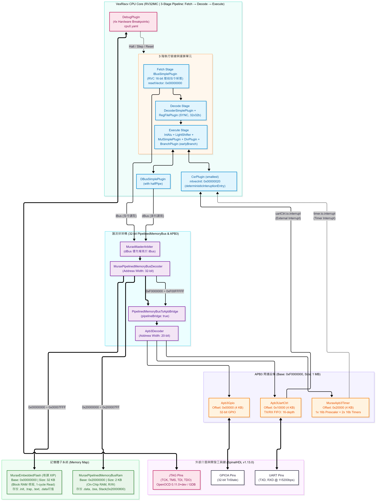

VexRISCV_SoC [[Back](./VexRISCV.md#VexRISCV_SoC)]
----

[VexRISCV](https://github.com/SpinalHDL/VexRiscv/tree/master#briey-soc) ASIC 案例
+ [Murax ](https://github.com/SpinalHDL/VexRiscv/tree/master#murax-soc)
    > Murax SoC 是一個極其輕量級、以 SpinalHDL 撰寫的開源 RISC-V SoC設計.
    它以 VexRiscv 處理器核心為基礎, 專門設計用來塞入像 Lattice iCE40 這樣資源極省的小型 FPGA 中
    >> license: `Apache 2.0`

    - Spec

        1. VexRiscv RV32I(M)
            > + 預設 `5-staages pipeline`
            > + Profile `Smallest` 則為 `2-stages pipeline`

        1. 內建 JTAG 偵錯器, 相容於 GDB 與 OpenOCD
        1. SRAM: `8 KBytes`, XIP with SPI-Flash (No Embedded Flash)
        1. 簡單的 System-Bus 和 APB3
        1. Interrupt (最多 32 個)
            > + Non-nested
            > + No Vector Table (所有 `interrupt` 和 `exception` 都進同一個 function)
            > + No Hardware Priority (由 Software 撰寫來決定)

        1. Peripheral
            > + APB 總線(APB bus for peripherals)
            > + 32 個 GPIO 引腳
            > + 一組 16-bit 預除器(prescaler)與兩組 16-bit 計時器(timers)
            > + 一組具備收發 FIFO 的 UAR

    - Performance
        > + Interlocked: 資料相依時, CPU等前一個 instruction 做完, 才會往下做
        > + Bypassed: 在 pipeline 各 stage 間建立 Bypass paths, 前一個 instruction 未做完時, 判定是否可以先做其他的 instruction (多 10~15% 邏輯單元)

        1. RV32I(Interlocked stages)
            > 約 `51 MHz`, 使用 2,387 個邏輯單元(LC), 效能約 `0.37 – 0.45 DMIPS/MHz`
        1. RV32I(Bypassed stages)
            > 約 `45 MHz`, 使用 2,718 個邏輯單元(LC), 效能約 `0.55 – 0.65 DMIPS/MHz`

    - 實際 ASIC 應用案例
        1. 開源 ASIC 生態與 Google SkyWater MPW 投片計畫
            > + Efabless Caravel 平台與 OpenLane 流程:
            Google 與 Efabless 推動的 `SkyWater 130nm` 開源製程計畫中,許多團隊採用 VexRiscv(或整合在 LiteX 下的 VexRiscv SoC)作為 Chip 的管理核心(Management Core)或運算核心,
            並直接透過開源 EDA 工具鏈(OpenLane / OpenROAD)完成從 RTL 到 GDSII 的實體設計與投片

            > + 微型晶片競賽與學術流片:
            在 `Tiny Tapeout` 等群眾募資的微型 ASIC 專案中,
            開發者經常利用 VexRiscv 精簡的插件機制(移除不必要的快取與浮點單元,將邏輯閘數壓縮至極低),
            在極小的矽晶面積內塞入完整的 32 位元 RISC-V 系統並完成實體晶片製造

        1. 安全控制與信任根(Root of Trust)協處理器
            > + 客製化安全指令與 PMP 隔離:
                VexRiscv 內建完整的`實體記憶體保護(PMP)`插件,且基於 SpinalHDL 的架構允許設計者在不更動主體管線的情況下,
                輕鬆插入自訂的加密加速指令(Custom Instructions)

            > + 商業化導入優勢:
                由於 VexRiscv 採用商業友善的開源授權,新創與晶片設計公司常將其作為大型 SoC 內部的`安全島(Security Island)`或管理子系統(Housekeeping MCU).
                這類應用不追求極致的時脈頻率,而是看重其面積小、驗證成熟,以及在 FPGA 模擬階段與 ASIC 量產階段能保持 100% 行為一致的特性

        1. 混合訊號(Mixed-Signal)與智慧感測器 ASIC
            > + 取代複雜狀態機:
                許多企業將極簡配置的 VexRiscv(例如 2 or 3 級管線、無快取配置)直接整合進類比混合訊號 ASIC 中,
                利用 C 語言韌體取代繁瑣的硬體狀態機控制邏輯

            > + FPGA 到 ASIC 的無痛轉移:
                開發團隊通常先在平價 FPGA 上運行 Efinix Sapphire 或 LiteX 的 VexRiscv SoC 進行感測器演算法驗證;
                待系統穩定後,直接將 SpinalHDL 產生的標準 Verilog,
                匯入 Synopsys Design Compiler 或 Cadence Genus 進行標準元件庫(Standard Cell)邏輯合成與 ASIC 投片

        1. AI 加速器與邊緣運算晶片的控制核心
            > + 低成本硬體(DMA)排程:
                相比於全硬體排程器,在 AI ASIC 內部嵌入幾顆 VexRiscv 核心,僅佔用極微小的晶片面積(約數萬個邏輯閘),卻能賦予加速器極高的軟體靈活性;
                開發者可透過自訂 CSR 暫存器讓 VexRiscv 直接控制內部 SRAM 與運算陣列的資料流,大幅縮短 AI 晶片的軟體適配與上市時程


+ [Briey](https://github.com/SpinalHDL/VexRiscv/tree/master#briey-soc)
    > Briey SoC 定位為高效能應用型(配備 I/D Cache 與外部 SDRAM 介面)


    - Spec

        1. VexRiscv RV32IMZicsr(C,A,F,D, Custom)
            > `5-Stage Pipeline`

        1. 內建 JTAG 偵錯器, 相容於 GDB 與 OpenOCD
        1. SRAM: `4 KBytes`(bootloader), SDRAM, XIP with SPI-Flash (No Embedded Flash)
        1. 完整 AXI4 Bus 和 APB3
        1. Peripheral
            > + I$ (I-Cache) and D$ (D-Cache)
            > + GPIO x 2
            > + UART
            > + VGA


## Peripheral

### Apb3Gpio (Base: 0xF0000000)

| Offset |暫存器名稱      | Bit-Fields  | 讀寫權限  | 功能說明
| :-     | :-            | :-          | :-       | :-
| 0x00   | INPUT         | [31:0]      | R        | 讀取外部 GPIO 接腳的當前邏輯準位狀態(經過同步器採樣).
| 0x04   | OUTPUT        | [31:0]      | R/W      | 設定 GPIO 輸出資料(當對應位元的 OUTPUT_ENABLE 為 1 時輸出至接腳).
| 0x08   | OUTPUT_ENABLE | [31:0]      | R/W      | 三態緩衝器方向控制:<br> 1: 輸出模式(Output);<br> 0: 高阻抗輸入模式(Input / Hi-Z,預設值).

### Apb3UartCtrl  (Base: 0xF0010000)

| Offset  | 暫存器名稱     | Bit-Fields | 讀寫權限  | 功能說明
| :-     | :-            | :-          | :-       | :-
| 0x00    | DATA          | [7:0]      | R/W      |  寫入: 將 1 byte 資料推入 TX FIFO 等待傳送.<br> 讀取: 從 RX FIFO 彈出(Pop)1 byte 已接收的資料.
|         |               | [15:8]     | —        |  保留(讀取為 0).
|         |               | [16]       | R        |  RX Data Valid(部分 SpinalHDL 版本支援):<br> 1 表示讀取到的 [7:0] 為有效資料(通常建議直接讀取 STATUS[31:24] 判斷是否有資料).
| 0x04    | STATUS        | [0]        | R/W      |  TX Interrupt Enable:<br> 1: 當 TX FIFO 為空時觸發中斷;<br> 0: 關閉(預設 0).
|         |               | [1]        | R/W      |  RX Interrupt Enable:<br> 1: 當 RX FIFO 非空(有資料可讀)時觸發中斷;<br> 0: 關閉(預設 0).
|         |               | [7:2]      | —        |  保留.
|         |               | [8]        | R        |  TX Interrupt Pending:<br> 1: 目前 TX 中斷條件成立(TX FIFO 空且 [0]=1).
|         |               | [9]        | R        |  RX Interrupt Pending:<br> 1: 目前 RX 中斷條件成立(RX FIFO 非空且 [1]=1).
|         |               | [15:10]    | —        |  保留.
|         |               | [23:16]    | R        |  TX FIFO Write Availability: 目前 TX FIFO 還可寫入的剩餘空間(0: 已滿,16: 全空). 傳送前需確認此欄位 `> 0`.
|         |               | [31:24]    | R        |  RX FIFO Read Occupancy: 目前 RX FIFO 內待讀取的位元組數量(0: 無資料,16: 已滿). 讀取前需確認此欄位 `> 0`.
| 0x08    | CLOCK_DIVIDER | [19:0]     | R        |  鮑率除頻器數值, 計算公式: `(F_clk / (Baudrate * SamplingSize)) - 1`. 因 Murax 鎖定配置,軟體寫入無效.
| 0x0C    | FRAME_CONFIG  | [7:0]      | R        |  資料位元長度(7 代表 8 bits). 因 Murax 鎖定配置,軟體寫入無效.
|         |               | [15:8]     | R        |  同位檢查設定(0: NONE; 1: EVEN; 2: ODD;).
|         |               | [23:16]    | R        |  停止位元設定(0: 1 stop bit; 1: 2 stop bits;).


### Prescaler 預分頻器 (Base: 0xF0020000)

用於將系統時脈分頻,產生一個週期性的溢位訊號(prescaler.io.overflow)供 Timer A 與 Timer B 使用。

| Offset  | 暫存器名稱 | Bit-Fields | 讀寫權限  | 功能說明
| :-     | :-         | :-         | :-       | :-
| 0x00   | LIMIT      | [15:0]     | R/W      | 計數器從 `0` 數到 `LIMIT` 後歸零並產生一個 tick 脈衝。 <br>公式: `F = PCLK / (LIMIT + 1)`。


### InterruptCtrl 中斷控制器 (Base: 0xF0020010)
管理 Timer A 與 Timer B 的中斷狀態與遮罩(Bit 0 對應 Timer A,Bit 1 對應 Timer B)。

| Offset  | 暫存器名稱 | Bit-Fields | 讀寫權限  | 功能說明
| :-      | :-        | :-         | :-       | :-
| 0x00    | PENDINGS  | [31:0]     | R/W1C    | 中斷掛起狀態,每個 bit 對應一個中斷<br> Read:<br> 1: 表示該計時器已觸發溢位中斷<br> Write: <br> 1: 清除對應位元的中斷旗標(Write-1-to-Clear,例如 TIMER_INTERRUPT->PENDINGS = 0x1;)
| 0x04    | MASKS     | [31:0]     | R/W      | 中斷致能遮罩 <br> 1: Enable <br> 0: Disable <br> Bit[0]: Timer A 中斷<br>Bit[1]: Timer B 中斷


### MuraxApb3Timer, Timer A (Base: 0xF0020040) 與 Timer B (Base: 0xF0020050)


| Offset | 暫存器名稱    | Bit-Fields | 讀寫權限   | 功能說明
| :-     | :-           | :-         | :-        | :-
| 0x00   | CLEARS_TICKS | [15:0]     | R/W       | TICKS: 選擇觸發計數器 +1 的時脈來源:<br>0x1 (Bit 0): 系統主時脈(每個 clock cycle 加 1)<br>0x2 (Bit 1): Prescaler 溢位訊號(預分頻後的 tick)
|        |              | [31:16]    | R/W       | CLEARS: 選擇觸發計數器自動歸零(Auto-reload)的條件:<br>1 (Bit 16): 當計數值達到 LIMIT(full)時自動歸零
| 0x04   | LIMIT        | [15:0]     | R/W       | 計數上限值,當 `VALUE == LIMIT` 時觸發 `full` 事件(產生中斷並依設定自動歸零)。<br> ps. 寫入此暫存器時硬體也會同步將 `VALUE` 清零。
| 0x08    | VALUE        | [15:0]     | R/W       | 目前計數值<br> Read: 回傳當前的計數器數值 <br>Write: 寫入任意值會直接將計數器清零


### Apb3SpiMasterCtrl (Base: 0xF0030000)


| Offset | 暫存器名稱     | Bit-Fields | 讀寫權限   | 功能說明
| :-     | :-            | :-         | :-        | :-
| 0x00   | DATA (W mode) | [7:0]      | W         | Tx Data(Tx FIFO) / SS_ID:(Mode=0) 欲送出的 8-bit TX 資料;(Mode=1) 片選編號(填 0)
|        |               | [23:8]     | —         | 保留.
|        |               | [24]       | W         | Read Enable (`Mode= 0`) <br>  1: 傳送同時將 MISO 推入 RX FIFO; <br>  0= 僅傳送不接收<br>SS Enable(`Mode= 1`)<br>  1: 啟用(Assert)對應的 SS 腳位;<br>  0: 關閉(De-assert)對應的 SS 腳位。
|        |               | [31:28]    | W         | Mode:0x0: 資料傳輸命令; <br>0x1: 片選(SS)控制命令
|        | DATA (R mode) | [7:0]      | R         | RX Data(Rx FIFO):從 MISO 接收到的 8-bit 資料
|        |               | [30:8]     | —         | 保留(讀出為 0).
|        |               | [31]       | R         | Valid Flag<br> 1: 讀取有效,且硬體自動將該筆資料彈出(Pop)RX FIFO; <br> 0: RX FIFO 為空,無有效資料
| 0x04   | STATUS        | [0]        | R/W       | Cmd Int Enable:<br> 1: 致能 TX 命令 FIFO 全空中斷;<br> 0: 關閉
|        |               | [1]        | R/W       | Rx Int Enable :<br> 1: 致能 RX FIFO 非空中斷;<br> 0: 關閉
|        |               | [8]        | R         | Cmd Int Pending :<br> 1: TX 命令 FIFO 全空中斷發生(寫入命令自動清除)
|        |               | [9]        | R         | RX Int Pending :<br> 1: RX FIFO 非空中斷發生(讀空 RX FIFO 自動清除)
|        |               | [31:16]    | R         | TX FIFO Avail :<br>TX 命令 FIFO 剩餘可用格數(滿空時為 32)
| 0x08   | CONFIG        | [0]        | W         | CPOL<br> 0: 閒置時 SCLK 為低電位(Mode 0/1);<br> 1: 閒置時為高電位(Mode 2/3)
|        |               | [1]        | W         | CPHA<br> 0: 第一個 SCLK 邊緣取樣(Mode 0/2);<br> 1: 第二個邊緣取樣(Mode 1/3)
|        |               | [4]        | W         | SS Active High<br> 0: ss 低電位有效(預設);<br> 1: ss 高電位有效
| 0x0C   | CLOCK_DIVIDER | [15:0]     | W         | Clock Div<br> SCLK 除頻值,輸出頻率 `F_sclk = F_sys /(2 *(Div+1))`, 12MHz 下設 5 得 1MHz
| 0x10   | SS_SETUP      | [15:0]     | W         | Setup Cycles<br> SS 啟用後,等待多少個系統時脈週期才發出第一個 SCLK
| 0x14   | SS_HOLD       | [15:0]     | W         | Hold Cycles<br> 最後一個 SCLK 結束後,維持 SS 有效多少個系統時脈週期
| 0x18   | SS_DISABLE    | [15:0]     | W         | Disable Cycles<br> 關閉 SS 後,至少等待多少個系統時脈週期才允許下次啟用


### Apb3I2cCtrl (Base: 0xF0040000)

| Offset | 暫存器名稱     | Bit-Fields | 讀寫權限   | 功能說明
| :-     | :-            | :-         | :-        | :-
| 0x00   | TX_DATA       | [7:0]      | R/W       | Value: 欲透過 SDA 傳送的 8-bit 資料(MSB First)
|        |               | [8]        | R/W       | Valid:<br> 1:  資料已就緒(完成 8-bit 傳輸後自動清為 0);<br> 0: 拉低 SCL 等待)
|        |               | [9]        | R/W       | Enable:<br> 1:  主動驅動 SDA 送出資料(Master 寫入);<br> 0: 釋放 SDA(Master 讀取)
|        |               | [10]       | R/W       | Repeat:<br> 1:  持續重複發送此筆資料;<br> 0: 單次發送(完成後清零 Bit 8)
|        |               | [11]       | R/W       | DisableOnConflict:<br> 1: 仲裁失敗時自動停止發送;<br> 0: 忽略衝突
| 0x04   | TX_ACK        | [0]        | R/W       | Value:<br> 0: 送出 ACK(拉低 SDA);<br> 1: 送出 NACK(釋放 SDA)
|        |               | [8]        | R/W       | Valid:<br> 1: ACK 設定已就緒;<br> 0: 於第 9 個時脈拉低 SCL 等待軟體寫入)
|        |               | [9]        | R/W       | Enable:<br> 1: 主動輸出 ACK/NACK(Master 讀完資料後); <br> 0: 釋放 SDA 收 Slave ACK
|        |               | [10]       | R/W       | Repeat:<br> 1: 重複套用此 ACK 設定;<br> 0: 單次有效(完成第 9 個時脈後清零 Bit 8)
| 0x08   | RX_DATA       | [7:0]      | R         | Value:<br> 第 1~8 個時脈採樣到的 8-bit 資料
|        |               | [8]        | R         | Valid:<br> 1: 已收到完整 1 Byte(CPU 讀取此暫存器後硬體自動清為 0)
|        |               | [9]        | RW        | Listen<br> 必須設為 1 才會將收到的資料推入 RX_DATA
| 0x0C   | RX_ACK        | [0]        | R         | Value:<br> 第 9 個時脈讀到的匯流排狀態(0: ACK, 1: NACK)
|        |               | [8]        | RC        | Valid:<br> 1: 已完成第 9 個時脈採樣(CPU 讀取後硬體自動清為 0)
|        |               | [9]        | RW        | Listen<br> 必須設為 1 才會將收到的資料推入 RX_DATA
| 0x20   | INT_ENABLE    | [0]        | R/W       | RX_DATA_FULL:<br> RX_DATA 收到新資料(Valid = 1)
|        |               | [1]        | R/W       | RX_ACK:<br> RX_ACK 收到新狀態(Valid = 1)
|        |               | [2]        | R/W       | TX_DATA_EMPTY:<br> TX_DATA 已送出變空(Valid = 0)
|        |               | [3]        | R/W       | TX_ACK:<br> TX_ACK 已送出變空(Valid = 0)
|        |               | [4]        | R/W       | START:<br> 匯流排偵測到 START / Repeated START 條件
|        |               | [5]        | R/W       | RESTART:<br>
|        |               | [6]        | R/W       | STOP:<br> 匯流排偵測到 STOP 條件
|        |               | [7]        | R/W       | DROP:<br> 傳輸異常中止或強制 Drop
| 0x24   | INT_FLAG      | -          | -         | 注意: RX_DATA 與 RX_ACK 中斷是 Level 觸發,無獨立 Flag 位元
|        |               | [4]        | R / W1C   | START:<br> 匯流排偵測到 START / Repeated START 條件
|        |               | [5]        | R / W1C   | RESTART:<br>
|        |               | [6]        | R / W1C   | STOP:<br> 匯流排偵測到 STOP 條件
|        |               | [7]        | R / W1C   | DROP:<br> 傳輸異常中止或強制 Drop
| 0x28   | SAMPLING_DIV  | [9:0]      | R/W       | Divider:<br> 輸入濾波取樣時脈除頻值,每 (Div + 1) 個系統時脈取樣一次 SDA/SCL
| 0x2C   | TIMEOUT       | [19:0]     | R/W       | Cycles:<br> SCL 持續為低電位超過此週期數則觸發逾時復位(`填 0 停用`)
| 0x30   | TSU_DAT       | [5:0]      | R/W       | Cycles:<br> SDA 變化後至釋放 SCL 上升緣之間的最小 Data Setup 時間週期數
| 0x40   | MASTER_STATUS | [0]        | R         | IsBusy:<br> 1: I2C 匯流排忙碌中(處於 START 與 STOP 之間);<br> 0: 匯流排閒置
|        |               | [4]        | R/W       | Start:<br> 1: 發送 START / Repeated START 條件(完成後自動清回 0)
|        |               | [5]        | R/W       | Stop:<br> 1: 發送 STOP 條件(完成後硬體自動清回 0)
|        |               | [6]        | R/W       | Drop:<br> 1: 強制中止傳輸並釋放匯流排(完成後硬體自動清回 0)
| 0x50   | TLOW          | [11:0]     | R/W       | Cycles: Master 模式下 SCL 低電位持續週期數(12MHz 跑 100kHz 設 60)
| 0x54   | THIGH         | [11:0]     | R/W       | Cycles: Master 模式下 SCL 高電位持續週期數(12MHz 跑 100kHz 設 60)
| 0x58   | TBUF          | [11:0]     | R/W       | Cycles: Master 模式下 STOP 後至下一次 START 的最小匯流排閒置週期數

### SysCtrl (Base: 0xF0050000)

| Offset | 暫存器名稱     | Bit-Fields | 讀寫權限   | 功能說明
| :-     | :-            | :-         | :-        | :-
| 0x00   | PINMUX_SEL0   | [1:0]      | R/W       | IOPAD[0]:<br> 0: GPIO<br>  1: UART/I2C/JTAG<br> 2: SPI<br> 3: 保留
|        |               | [3:2]      | R/W       | IOPAD[1]:<br> 0: GPIO<br>  1: UART/I2C/JTAG<br> 2: SPI<br> 3: 保留
|        |               | [5:4]      | R/W       | IOPAD[2]:<br> 0: GPIO<br>  1: UART/I2C/JTAG<br> 2: SPI<br> 3: 保留
|        |               | [7:6]      | R/W       | IOPAD[3]:<br> 0: GPIO<br>  1: UART/I2C/JTAG<br> 2: SPI<br> 3: 保留
|        |               | [9:8]      | R/W       | IOPAD[4]:<br> 0: GPIO<br>  1: UART/I2C/JTAG<br> 2: SPI<br> 3: 保留
|        |               | [11:10]    | R/W       | IOPAD[5]:<br> 0: GPIO<br>  1: UART/I2C/JTAG<br> 2: SPI<br> 3: 保留
|        |               | [13:12]    | R/W       | IOPAD[6]:<br> 0: GPIO<br>  1: UART/I2C/JTAG<br> 2: SPI<br> 3: 保留
|        |               | [15:14]    | R/W       | IOPAD[7]:<br> 0: GPIO<br>  1: UART/I2C/JTAG<br> 2: SPI<br> 3: 保留
| 0x04   | PINMUX_SEL1   | [1:0]      | R/W       | IOPAD[8]:<br> 0: GPIO<br>  1: UART/I2C/JTAG<br> 2: SPI<br> 3: 保留
|        |               | [3:2]      | R/W       | IOPAD[9]:<br> 0: GPIO<br>  1: UART/I2C/JTAG<br> 2: SPI<br> 3: 保留
|        |               | [5:4]      | R/W       | IOPAD[10]:<br> 0: GPIO<br>  1: UART/I2C/JTAG<br> 2: SPI<br> 3: 保留
|        |               | [7:6]      | R/W       | IOPAD[11]:<br> 0: GPIO<br>  1: UART/I2C/JTAG<br> 2: SPI<br> 3: 保留
|        |               | [9:8]      | R/W       | IOPAD[12]:<br> 0: GPIO<br>  1: UART/I2C/JTAG<br> 2: SPI<br> 3: 保留
|        |               | [11:10]    | R/W       | IOPAD[13]:<br> 0: GPIO<br>  1: UART/I2C/JTAG<br> 2: SPI<br> 3: 保留
|        |               | [13:12]    | R/W       | IOPAD[14]:<br> 0: GPIO<br>  1: UART/I2C/JTAG<br> 2: SPI<br> 3: 保留
|        |               | [15:14]    | R/W       | IOPAD[15]:<br> 0: GPIO<br>  1: UART/I2C/JTAG<br> 2: SPI<br> 3: 保留
| 0x08   | SYS_STATUS    | [7:0]      | R         | 周邊版本辨識碼(0x16)
|        |               | [31:16]    | R         | 核心時脈 MHz (32)

## Pin Mux


| 實體腳位       | Mode 0 (2'b00)  | Mode 1 (2'b01 - 開機 JTAG 預設) | Mode 2 (2'b10)  | Open-Drain / 電氣特性說明
| :-            | :-              | :-                              | :-              | :-
| IOPAD[0]      | GPIO[0]         | UART_TXD (推挽輸出)             | —               | —
| IOPAD[1]      | GPIO[1]         | UART_RXD (輸入)                 | —               | —
| IOPAD[2]      | GPIO[2]         | I2C_SCL (Open-Drain)           |  —               | 輸出固定 0,writeEnable = ~scl.write
| IOPAD[3]      | GPIO[3]         | I2C_SDA (Open-Drain)           |  —               | 輸出固定 0,writeEnable = ~sda.write
| IOPAD[4]      | GPIO[4]         | —                              |  SPI_SS[0] (輸出) | —
| IOPAD[5]      | GPIO[5]         | —                              |  SPI_SCLK (輸出)  | —
| IOPAD[6]      | GPIO[6]         | —                              |  SPI_MOSI (輸出)  | —
| IOPAD[7]      | GPIO[7]         | —                              |  SPI_MISO (輸入)  | —
| IOPAD[8..11]  | GPIO[8..11]     | —                              |  —                | 純通用 GPIO
| IOPAD[12]     | GPIO[12]        | JTAG_TMS (預設)                 | —                | 重置後預設為 Mode 1 (0x1),確保上電即支援 OpenOCD
| IOPAD[13]     | GPIO[13]        | JTAG_TCK (預設)                 | —                | 重置後預設為 Mode 1 (0x1)
| IOPAD[14]     | GPIO[14]        | JTAG_TDI (預設)                 | —                | 重置後預設為 Mode 1 (0x1)
| IOPAD[15]     | GPIO[15]        | JTAG_TDO (預設)                 | —                | 重置後預設為 Mode 1 (0x1)


# `Customization 1` (Use 3-stages pipeline base on default `Murax`)

+ Change Items

    - `2-stages pipeline` 需要做非同步處理,造成需要較高電路實現,因此改為 `3-stages pipeline`

+ Toolchain: [riscv-collab/riscv-gnu-toolchain: riscv32-elf-2022.11.16 · GitHub](https://github.com/riscv-collab/riscv-gnu-toolchain/releases/tag/2022.11.16)

## diff (from Gemini)

[GitHub - SpinalHDL/VexRiscv · GitHub](https://github.com/SpinalHDL/VexRiscv/tree/master#murax-soc)
> base on SHA ID `baf7dc8`

+ Base on `src/main/scala/vexriscv/demo/Murax.scala`
    > [Murax_3Stages Diff file](VexRISCV/Murax_3Stages.diff)

    - 修改重點說明

        1. CsrPlugin(第 89–94 行)
            > 在原本的 `CsrPluginConfig.smallest(...)` 上透過 `.copy()` 關閉 `pipelineCsrRead`(避免 CSR 讀取往後延遲)
            並開啟 `deterministicInteruptionEntry = true`(確保中斷在 Execute 階段穩定觸發)

        1. BranchPlugin(第 113 行)
            > 將 `earlyBranch` 從 false 改為 true, 讓分支跳躍在 Execute 階段直接解析, 不需等待不存在的 Memory 階段

        1. VexRiscvConfig 與 DebugPlugin(第 234–239 行)
            > 增加設定 `withMemoryStage = false` 與 `withWriteBackStage = false` 來取消 Memory 與 WriteBack 2 管線


        1. 原生中斷接線保留
            > 原生版本在 APB 周邊區塊(第 273 行與第 277 行)已經包含 `externalInterrupt setWhen(uartCtrl.io.interrupt)`
            與 `timerInterrupt setWhen(timer.io.interrupt)`, 因此不需要額外改動即可直接支援 UART 與 Timer 中斷.


## 生成 RTL code

```
$ cd <VexRiscv_Root>
$ vi z_gen_rtl.sh
    #!/bin/bash

    sbt "runMain vexriscv.demo.MuraxWithRamInit"  # 生成 Murax.v
    sed -i 's/\$urandom/\$random/g' Murax.v

$ ./z_gen_rtl.sh
```

+ `$urandom` 錯誤: 舊版 Verilator 尚未支援無參數的 `$urandom`
    > 對已經產生的 `Murax.v` 裡的 `$urandom` 替換成舊版 Verilator 支援的 `$random`

    ```
    $ sed -i 's/\$urandom/\$random/g' Murax.v
    ```

## 啟動 Verilator 模擬環境

> 如果運作正常, 終端機會立刻將你輸入的字元 Echo 印出來

```
$ cd <VexRiscv_Root>/src/test/cpp/murax
$ make clean run    # 使用 <VexRiscv_Root>/src/main/ressource/hex/muraxDemo.hex
$ make clean run
    rm -rf obj_dir
    rm -f Murax.v*.bin
    rm -f Murax.v*.bin
    cp ../../../../Murax.v*.bin . | true
    verilator -I../../../.. -cc  ../../../../Murax.v -CFLAGS -pthread -LDFLAGS -pthread -CFLAGS "-O3" -CFLAGS -DTRACE_START=0 --gdbbt  -Wno-WIDTH -Wno-UNOPTFLAT --x-assign unique --exe main.cpp
    No stack.
    make  -j  -C obj_dir/ -f VMurax.mk VMurax
    make[1]: Entering directory '<VexRiscv>/src/test/cpp/murax/obj_dir'
    g++  -I.  -MMD -I/usr/share/verilator/include -I/usr/share/verilator/include/vltstd -DVM_COVERAGE=0 -DVM_SC=0 -DVM_TRACE=0 -faligned-new -fcf-protection=none -Wno-bool-operation -Wno-sign-compare -Wno-uninitialized -Wno-unused-but-set-variable -Wno-unused-parameter -Wno-unused-variable -Wno-shadow     -pthread -O3 -DTRACE_START=0  -Os -c -o main.o ../main.cpp
    g++  -I.  -MMD -I/usr/share/verilator/include -I/usr/share/verilator/include/vltstd -DVM_COVERAGE=0 -DVM_SC=0 -DVM_TRACE=0 -faligned-new -fcf-protection=none -Wno-bool-operation -Wno-sign-compare -Wno-uninitialized -Wno-unused-but-set-variable -Wno-unused-parameter -Wno-unused-variable -Wno-shadow     -pthread -O3 -DTRACE_START=0  -Os -c -o verilated.o /usr/share/verilator/include/verilated.cpp
    g++  -I.  -MMD -I/usr/share/verilator/include -I/usr/share/verilator/include/vltstd -DVM_COVERAGE=0 -DVM_SC=0 -DVM_TRACE=0 -faligned-new -fcf-protection=none -Wno-bool-operation -Wno-sign-compare -Wno-uninitialized -Wno-unused-but-set-variable -Wno-unused-parameter -Wno-unused-variable -Wno-shadow     -pthread -O3 -DTRACE_START=0  -Os -c -o verilated_dpi.o /usr/share/verilator/include/verilated_dpi.cpp
    /usr/bin/perl /usr/share/verilator/bin/verilator_includer -DVL_INCLUDE_OPT=include VMurax.cpp VMurax_Murax.cpp VMurax_VexRiscv.cpp VMurax__Dpi.cpp VMurax__Slow.cpp VMurax_Murax__Slow.cpp VMurax_VexRiscv__Slow.cpp VMurax__Syms.cpp > VMurax__ALL.cpp
    g++  -I.  -MMD -I/usr/share/verilator/include -I/usr/share/verilator/include/vltstd -DVM_COVERAGE=0 -DVM_SC=0 -DVM_TRACE=0 -faligned-new -fcf-protection=none -Wno-bool-operation -Wno-sign-compare -Wno-uninitialized -Wno-unused-but-set-variable -Wno-unused-parameter -Wno-unused-variable -Wno-shadow     -pthread -O3 -DTRACE_START=0  -Os -c -o VMurax__ALL.o VMurax__ALL.cpp
    ar -cr VMurax__ALL.a VMurax__ALL.o
    ranlib VMurax__ALL.a
    g++    main.o verilated.o verilated_dpi.o VMurax__ALL.a   -pthread    -o VMurax
    make[1]: Leaving directory '<VexRiscv>/src/test/cpp/murax/obj_dir'
    ./obj_dir/VMurax
    BOOT
    A
```

+ `BOOT` 字樣
    > 這是 `muraxDemo.hex` 韌體上電初始化後, 透過 UART 傳送出來的第一串開機訊息,
    代表 `3-stages pipeline`(Fetch + Decode + Execute)、SRAM 指令讀取以及 APB 與 UART 全都運作無誤

+ `A` 字元迴響
    > 這代表輸入的 `A` 成功透過 UART RX 接收, 觸發了硬體中斷(uartCtrl.io.interrupt -> externalInterrupt),
    並且 CPU 成功進入 CsrPlugin 的中斷服務常式(ISR), 再透過 UART TX 將字元印回終端機


### The target hex file of Verilator

+ Default target hex file (Verilator 自動 download)
    > 需要重新產生 RTL code

    ```
    $ vi src/main/scala/vexriscv/demo/Murax.scala
        ...
        // object MuraxWithRamInit{
        //   def main(args: Array[String]) {
        //     SpinalVerilog(Murax(MuraxConfig.default.copy(onChipRamSize = 4 kB, onChipRamHexFile = "src/main/ressource/hex/muraxDemo.hex
        //   }
        // }

        object MuraxWithRamInit{
          def main(args: Array[String]) {
            SpinalVerilog(Murax(MuraxConfig.default.copy(
              onChipRamSize = 8 kB,                                                     // 調整可執行的 SRAM 大小
              onChipRamHexFile = "src/main/c/murax/hello_world/build/hello_world.hex"   // 目標 hex 檔 (hard code)
            )))
          }
        }
    ```

+ Replay `toplevel_system_ram_ram_symbol.bin`
    > 不用重新生成 RTL code (sbt 會將 onChipRamHexFile 分割成 symbol files)

    - python script [z_update_ram.py](z_update_ram.py)

        ```
        $ cd <VexRiscv_Root>

        $ cd <VexRiscv_Root>/src/main/c/murax/hello_world/
        $ make clean && make
        $ riscv32-unknown-elf-objcopy -O binary ./build/hello_world.elf ./build/hello_world.bin
        $ z_update_ram.py -i <VexRiscv_Root>/src/main/c/murax/hello_world/build/hello_world.bin
        $ cp -f ./Murax.v_toplevel_system_ram_ram_symbol0.bin <VexRiscv_Root>/
        $ cp -f ./Murax.v_toplevel_system_ram_ram_symbol1.bin <VexRiscv_Root>/
        $ cp -f ./Murax.v_toplevel_system_ram_ram_symbol2.bin <VexRiscv_Root>/
        $ cp -f ./Murax.v_toplevel_system_ram_ram_symbol3.bin <VexRiscv_Root>/

        $ cd <VexRiscv_Root>/src/test/cpp/murax
        $ ./obj_dir/VMurax
        ```


## OpenOCD Server (for Verilator Simulation)

+ `murax.cfg` for OpenOCD

    ```
    adapter driver jtag_tcp
    adapter speed 1000

    set _CHIPNAME riscv
    # 關鍵修正 1: Murax.v 的 jtag_tap_instruction 是 4-bit,必須設為 -irlen 4
    jtag newtap $_CHIPNAME cpu -irlen 4 -expected-id 0x10001fff

    set _TARGETNAME $_CHIPNAME.cpu
    target create $_TARGETNAME vexriscv -endian little -chain-position $_TARGETNAME

    # 關鍵修正 2: 對應 JtagBridge (IR_WRITE=2, IR_READ=3, DR_WRITE_OFFSET=0, DR_READ_OFFSET=0, DR_WRITE_LEN=0, DR_READ_LEN=0)
    vexriscv jtagMapping 2 3 0 0 0 0
    vexriscv cpuConfigFile cpu0.yaml
    vexriscv readWaitCycles 40

    reset_config none
    init
    ```

+ Start OpenOCD server
    > 需使用 VexRISCV 特製的 OpenOCD 版本

    ```
    $ openocd -f murax.cfg
        Open On-Chip Debugger 0.11.0+dev-04036-ga0220ad30 (2026-11-11-17:21)
        Licensed under GNU GPL v2
        For bug reports, read
                http://openocd.org/doc/doxygen/bugs.html
        Info : only one transport option; autoselect 'jtag'
        Info : clock speed 1000 kHz
        Info : JTAG tap: riscv.cpu tap/device found: 0x10001fff (mfg: 0x7ff (<invalid>), part: 0x0001, ver: 0x1)
        Error: ERROR: Error while reading from socket: Socket operation on non-socket
        [riscv.cpu] Target successfully examined.
        Info : starting gdb server for riscv.cpu on 3333
        Info : Listening on port 3333 for gdb connections
        Info : Listening on port 6666 for tcl connections
        Info : Listening on port 4444 for telnet connections
        Info : accepting 'gdb' connection on tcp/3333
        Warn : Prefer GDB command "target extended-remote :3333" instead of "target remote :3333"
        Info : JTAG tap: riscv.cpu tap/device found: 0x10001fff (mfg: 0x7ff (<invalid>), part: 0x0001, ver: 0x1)
        Info : dropped 'gdb' connection
        Info : accepting 'gdb' connection on tcp/3333
        Info : JTAG tap: riscv.cpu tap/device found: 0x10001fff (mfg: 0x7ff (<invalid>), part: 0x0001, ver: 0x1)
        Info : JTAG tap: riscv.cpu tap/device found: 0x10001fff (mfg: 0x7ff (<invalid>), part: 0x0001, ver: 0x1)

    ```

## GDB client

因為程式執行在 SRAM, 因此可以動態再 `load` bin 到 SRAM 執行
> 若要用 `eFlash` 需要另外實作 `xip`, `program flash`, ...等

```
$ cd <VexRiscv_Root>/src/main/c/murax/hello_world
$ make clean && make

$ riscv32-unknown-elf-gdb -tui ./build/hello_world.elf -ex "target extended-remote :3333" -ex "monitor reset halt"
GNU gdb (GDB) 12.1
...

(gdb) load  # run-time load the target elf to DUT
(gdb) si    # execte the 1st instruction (start at 'crtStart')
```

# `Customization 2` (Use 3-stages pipeline base on default `Murax` + eFlash)

+ Change Items
    - 增加 eFlash

+ Memory mapping
    > + eFlash: base= 0x0, 32KBytes
    > + SRAM: base= 0x20000000, 2KBytes

+ Toolchain: [riscv-collab/riscv-gnu-toolchain: riscv32-elf-2022.11.16 · GitHub](https://github.com/riscv-collab/riscv-gnu-toolchain/releases/tag/2022.11.16)

## diff (from Gemini)

[GitHub - SpinalHDL/VexRiscv · GitHub](https://github.com/SpinalHDL/VexRiscv/tree/master#murax-soc)
> base on SHA ID `baf7dc8`

+ Base on `src/main/scala/vexriscv/demo/Murax.scala`
    > [Murax_3Stages_eFlash Diff file](VexRISCV/Murax_3Stages_eFlash.diff)

+ 編譯新 MMP 的 Application

    ```
    $ cd <VexRiscv_Root>/src/main/c/murax
    $ cp -fr ./hello_world ./my_hello
    $ cd my_hello
    $ vi src/crt.S      # modify
    $ vi src/linker.ld  # modify
    $ make clean && make

    # Default hex path of Verilator
    $ cp ./build/my_hello.hex  <VexRiscv_Root>/src/main/ressource/hex/

    ```

    - `crt.S`

        ```
        .global main
        .global irqCallback

        .section .init, "ax"
        .global _start
        _start:
          /* 關閉全域中斷 (MIE = 0) */
          csrci mstatus, 8

          /* 跳過 0x20 的中斷向量區段,前往初始化流程 */
          j _init_system

        /* 中斷向量入口 (對齊於 0x00000020) */
        .section .trap, "ax"
        .global trap_entry
        trap_entry:
          addi sp, sp, -64
          sw ra,   0(sp)
          sw t0,   4(sp)
          sw t1,   8(sp)
          sw t2,  12(sp)
          sw a0,  16(sp)
          sw a1,  20(sp)
          sw a2,  24(sp)
          sw a3,  28(sp)
          sw a4,  32(sp)
          sw a5,  36(sp)
          sw a6,  40(sp)
          sw a7,  44(sp)
          sw t3,  48(sp)
          sw t4,  52(sp)
          sw t5,  56(sp)
          sw t6,  60(sp)

          /* 呼叫 C 語言中斷處理函式 (若無定義則可改為弱符號或直接返回) */
          call irqCallback

          lw ra,   0(sp)
          lw t0,   4(sp)
          lw t1,   8(sp)
          lw t2,  12(sp)
          lw a0,  16(sp)
          lw a1,  20(sp)
          lw a2,  24(sp)
          lw a3,  28(sp)
          lw a4,  32(sp)
          lw a5,  36(sp)
          lw a6,  40(sp)
          lw a7,  44(sp)
          lw t3,  48(sp)
          lw t4,  52(sp)
          lw t5,  56(sp)
          lw t6,  60(sp)
          addi sp, sp, 64
          mret

        .section .text
        _init_system:
          /* 設定堆疊指標 (Stack Pointer = 0x80000800) */
          la sp, _stack_start

          /* 1. 將 .data 從 Flash (_data_lma) 搬移至 SRAM (_data_vma_start ~ _data_vma_end) */
          la a0, _data_lma
          la a1, _data_vma_start
          la a2, _data_vma_end
          bgeu a1, a2, _copy_data_done

        _copy_data_loop:
          lw t0, 0(a0)
          sw t0, 0(a1)
          addi a0, a0, 4
          addi a1, a1, 4
          bltu a1, a2, _copy_data_loop

        _copy_data_done:
          /* 2. 將 SRAM 中的 .bss 區段清零 (_bss_start ~ _bss_end) */
          la a0, _bss_start
          la a1, _bss_end
          bgeu a0, a1, _clear_bss_done

        _clear_bss_loop:
          sw zero, 0(a0)
          addi a0, a0, 4
          bltu a0, a1, _clear_bss_loop

        _clear_bss_done:
          /* 確保 mtvec 指向 trap_entry (0x00000020) */
          la t0, trap_entry
          csrw mtvec, t0

          /* 呼叫 C 語言主程式 */
          call main

        /* 若 main() 返回,進入無窮迴圈 */
        _exit_loop:
          j _exit_loop

        /* 提供預設的弱符號 irqCallback,避免未定義中斷函式時連結錯誤 */
        .weak irqCallback
        irqCallback:
          ret

        ```

    - `linker.ld`

        ```
        /*
        This is free and unencumbered software released into the public domain.

        Anyone is free to copy, modify, publish, use, compile, sell, or
        distribute this software, either in source code form or as a compiled
        binary, for any purpose, commercial or non-commercial, and by any
        means.
        */
        OUTPUT_FORMAT("elf32-littleriscv", "elf32-littleriscv", "elf32-littleriscv")
        OUTPUT_ARCH(riscv)


        ENTRY(_start)

        MEMORY
        {
          FLASH (rx)  : ORIGIN = 0x00000000, LENGTH = 32K
          RAM   (rwx) : ORIGIN = 0x20000000, LENGTH = 2K
        }

        SECTIONS
        {
          /* 程式進入點與中斷向量表 (位於 0x00000000) */
          .text :
          {
            . = ALIGN(4);
            KEEP(*(.init))
            /* 確保中斷向量表對齊 0x00000020 (對應 CsrPlugin 的 mtvecInit) */
            . = 0x20;
            KEEP(*(.trap))
            *(.text .text.*)
            *(.rodata .rodata.*)
            *(.srodata .srodata.*)
            . = ALIGN(4);
          } > FLASH

          /* 記錄 .data 在 Flash 中的起始位置 (Load Memory Address) */
          _data_lma = LOADADDR(.data);

          /* 已初始化的全域/靜態變數 (執行時位於 SRAM, 初始值存於 Flash) */
          .data :
          {
            . = ALIGN(4);
            _data_vma_start = .;
            *(.data .data.*)
            *(.sdata .sdata.*)
            . = ALIGN(4);
            _data_vma_end = .;
          } > RAM AT > FLASH

          /* 未初始化變數區段 (位於 SRAM, 開機清零) */
          .bss (NOLOAD) :
          {
            . = ALIGN(4);
            _bss_start = .;
            *(.bss .bss.*)
            *(.sbss .sbss.*)
            *(COMMON)
            . = ALIGN(4);
            _bss_end = .;
          } > RAM

          /* 堆疊指標設在 2KB SRAM 的最頂端 (0x20000000 + 0x800) */
          PROVIDE(_stack_start = ORIGIN(RAM) + LENGTH(RAM));
        }
        ```


## 生成 RTL code

```
$ cd <VexRiscv_Root>
$ vi z_gen_rtl.sh
    #!/bin/bash

    sbt "runMain vexriscv.demo.MuraxWithRamInit"  # 生成 Murax.v
    sed -i 's/\$urandom/\$random/g' Murax.v

$ ./z_gen_rtl.sh
```

## 啟動 Verilator 模擬環境

```
[<VexRiscv_Root>/src/test/cpp/murax] (sha:baf7dc8)
$ make clean run
rm -rf obj_dir
rm -f Murax.v*.bin
rm -f Murax.v*.bin
cp ../../../../Murax.v*.bin . | true
verilator -I../../../.. -cc  ../../../../Murax.v -CFLAGS -pthread -LDFLAGS -pthread -CFLAGS "-O3" -CFLAGS -DTRACE_START=0 --gdbbt  -Wno-WIDTH -Wno-UNOPTFLAT --x-assign unique --exe main.cpp
No stack.
make  -j  -C obj_dir/ -f VMurax.mk VMurax
make[1]: Entering directory '<VexRiscv>/src/test/cpp/murax/obj_dir'
g++  -I.  -MMD -I/usr/share/verilator/include -I/usr/share/verilator/include/vltstd -DVM_COVERAGE=0 -DVM_SC=0 -DVM_TRACE=0 -faligned-new -fcf-protection=none -Wno-bool-operation -Wno-sign-compare -Wno-uninitialized -Wno-unused-but-set-variable -Wno-unused-parameter -Wno-unused-variable -Wno-shadow     -pthread -O3 -DTRACE_START=0  -Os -c -o main.o ../main.cpp
g++  -I.  -MMD -I/usr/share/verilator/include -I/usr/share/verilator/include/vltstd -DVM_COVERAGE=0 -DVM_SC=0 -DVM_TRACE=0 -faligned-new -fcf-protection=none -Wno-bool-operation -Wno-sign-compare -Wno-uninitialized -Wno-unused-but-set-variable -Wno-unused-parameter -Wno-unused-variable -Wno-shadow     -pthread -O3 -DTRACE_START=0  -Os -c -o verilated.o /usr/share/verilator/include/verilated.cpp
g++  -I.  -MMD -I/usr/share/verilator/include -I/usr/share/verilator/include/vltstd -DVM_COVERAGE=0 -DVM_SC=0 -DVM_TRACE=0 -faligned-new -fcf-protection=none -Wno-bool-operation -Wno-sign-compare -Wno-uninitialized -Wno-unused-but-set-variable -Wno-unused-parameter -Wno-unused-variable -Wno-shadow     -pthread -O3 -DTRACE_START=0  -Os -c -o verilated_dpi.o /usr/share/verilator/include/verilated_dpi.cpp
/usr/bin/perl /usr/share/verilator/bin/verilator_includer -DVL_INCLUDE_OPT=include VMurax.cpp VMurax_Murax.cpp VMurax_VexRiscv.cpp VMurax__Dpi.cpp VMurax__Slow.cpp VMurax_Murax__Slow.cpp VMurax_VexRiscv__Slow.cpp VMurax__Syms.cpp > VMurax__ALL.cpp
g++  -I.  -MMD -I/usr/share/verilator/include -I/usr/share/verilator/include/vltstd -DVM_COVERAGE=0 -DVM_SC=0 -DVM_TRACE=0 -faligned-new -fcf-protection=none -Wno-bool-operation -Wno-sign-compare -Wno-uninitialized -Wno-unused-but-set-variable -Wno-unused-parameter -Wno-unused-variable -Wno-shadow     -pthread -O3 -DTRACE_START=0  -Os -c -o VMurax__ALL.o VMurax__ALL.cpp
ar -cr VMurax__ALL.a VMurax__ALL.o
ranlib VMurax__ALL.a
g++    main.o verilated.o verilated_dpi.o VMurax__ALL.a   -pthread    -o VMurax
make[1]: Leaving directory '<VexRiscv>/src/test/cpp/murax/obj_dir'
./obj_dir/VMurax
BOOT
hello world arty a7 v1

```

## OpenOCD Server (for Verilator Simulation)

+ `murax.cfg` for OpenOCD

    ```
    adapter driver jtag_tcp
    adapter speed 1000

    set _CHIPNAME riscv
    # 關鍵修正 1: Murax.v 的 jtag_tap_instruction 是 4-bit,必須設為 -irlen 4
    jtag newtap $_CHIPNAME cpu -irlen 4 -expected-id 0x10001fff

    set _TARGETNAME $_CHIPNAME.cpu
    target create $_TARGETNAME vexriscv -endian little -chain-position $_TARGETNAME

    # 關鍵修正 2: 對應 JtagBridge (IR_WRITE=2, IR_READ=3, DR_WRITE_OFFSET=0, DR_READ_OFFSET=0, DR_WRITE_LEN=0, DR_READ_LEN=0)
    vexriscv jtagMapping 2 3 0 0 0 0
    vexriscv cpuConfigFile cpu0.yaml
    vexriscv readWaitCycles 40

    reset_config none
    init
    ```

+ Start OpenOCD server
    > 需使用 VexRISCV 特製的 OpenOCD 版本

    ```
    $ openocd -f ./murax.cfg
        Open On-Chip Debugger 0.11.0+dev-04036-ga0220ad30 (2026-11-11-17:21)
        Licensed under GNU GPL v2
        For bug reports, read
                http://openocd.org/doc/doxygen/bugs.html
        Info : only one transport option; autoselect 'jtag'
        Info : clock speed 1000 kHz
        Info : JTAG tap: riscv.cpu tap/device found: 0x10001fff (mfg: 0x7ff (<invalid>), part: 0x0001, ver: 0x1)
        Error: ERROR: Error while reading from socket: Socket operation on non-socket
        [riscv.cpu] Target successfully examined.
        Info : starting gdb server for riscv.cpu on 3333
        Info : Listening on port 3333 for gdb connections
        Info : Listening on port 6666 for tcl connections
        Info : Listening on port 4444 for telnet connections
        Info : accepting 'gdb' connection on tcp/3333
        Warn : Prefer GDB command "target extended-remote :3333" instead of "target remote :3333"
        Info : JTAG tap: riscv.cpu tap/device found: 0x10001fff (mfg: 0x7ff (<invalid>), part: 0x0001, ver: 0x1)
        Info : JTAG tap: riscv.cpu tap/device found: 0x10001fff (mfg: 0x7ff (<invalid>), part: 0x0001, ver: 0x1)
    ```


## GDB client

```
$ cd <VexRiscv_Root>/src/main/c/murax/my_hello
$ make clean && make

$ riscv32-unknown-elf-gdb -tui ./build/my_hello.elf -ex "target extended-remote :3333"
GNU gdb (GDB) 12.1
...

(gdb) monitor reset halt    # reset DUT
(gdb) si                    # execte the 1st instruction (start at 'crtStart')
(gdb) hbreak main
(gdb) c
```


# `Customization 3` (Use 3-stages pipeline base on default `Murax` + eFlash + RV32IMC)

+ Change Items
    - 增加 `RV32IMC` extensions

+ Memory mapping
    > + eFlash: base= 0x0, 32KBytes
    > + SRAM: base= 0x20000000, 2KBytes

+ Toolchain: [riscv-collab/riscv-gnu-toolchain: riscv32-elf-2022.11.16 · GitHub](https://github.com/riscv-collab/riscv-gnu-toolchain/releases/tag/2022.11.16)

+ System-Arch

    


## diff (from Gemini)

[GitHub - SpinalHDL/VexRiscv · GitHub](https://github.com/SpinalHDL/VexRiscv/tree/master#murax-soc)
> base on SHA ID `baf7dc8`

+ Base on `src/main/scala/vexriscv/demo/Murax.scala`
    > [Murax_3Stages_rv32imc_eFlash Diff file](VexRISCV/Murax_3Stages_rv32imc_eFlash.diff)


## Application configuration

+ 編譯新 MMP 的 Application

    ```
    $ cd <VexRiscv_Root>/src/main/c/murax
    $ cp -fr ./hello_world ./my_hello
    $ cd my_hello
    $ vi src/crt.S      # modify
    $ vi src/linker.ld  # modify
    $ vi makeile
        ...
        #
        # RISC-V Extension 修改為 'rv32imc',
        # 有些較新的 GCC 會要求加上 'rv32imc_zicsr'
        #
        CFLAGS += -march=rv32imc -mabi=ilp32
        LDFLAGS += -march=rv32imc -mabi=ilp32
        ...

    $ make clean && make

    # Default hex path of Verilator
    $ cp ./build/my_hello.hex  <VexRiscv_Root>/src/main/ressource/hex/
    ```


# `Customization 4` (Use 3-stages pipeline base on default `Murax` + eFlash + RV32IMC + I2C + SPI)

+ Change Items
    - 增加 I2C/SPI

+ Memory mapping
    > + eFlash: base= 0x0, 32KBytes
    > + SRAM: base= 0x20000000, 2KBytes

+ Toolchain: [riscv-collab/riscv-gnu-toolchain: riscv32-elf-2022.11.16 · GitHub](https://github.com/riscv-collab/riscv-gnu-toolchain/releases/tag/2022.11.16)

+ The test example is referenced at `./VexRISCV/example/my_test_rv32imc`

    - Build Application program

        ```
        $ cd <VexRiscv>/src/main/c/murax/my_test_rv32imc
        $ vi z_update_bin.sh
            #!/bin/bash

            make clean && make

            ./z_update_ram.py -i ./build/my_test.bin -t flash

            cp -f Murax.v_toplevel_system_eFlash_flash.bin <VexRiscv>/

        $ ./z_update_bin.sh  # Compile App and copy to '<VexRiscv>/Murax.v_toplevel_system_eFlash_flash.bin'
        ```

    - 測試項目如下

        ```
        ...
        ving directory '<VexRiscv>/src/test/cpp/murax/obj_dir'
        ./obj_dir/VMurax
        BOOT
        CONNECTED

        ========================================
        VexRiscv Murax SoC Core & Timer Test
        ========================================
        [Test 0] CSR Check:
            MIE     = 0x00000880
            MSTATUS = 0x00001808

        [Test 1] SRAM .data & .bss Check:
            Init .data (expect 0x12345678) = 0x12345678
            Init .bss  (expect 0x00000000) = 0x00000000
            -> PASS!

        [Test 2] RV32M Hardware Mul/Div Check:
            MUL = 0x04FED79D
            DIV = 0x000A65A7
            REM = 0x00000060
            -> PASS!

        [Test 3] Timer Interrupt (mcause 0x80000007):
            Timer ticks = 0x00000005
            -> PASS!

        [Test 4] UART RX Interrupt (mcause 0x8000000B):
            [Waiting] Please type a character and press Enter...
            hhh
            hhh
            UART RX IRQ Count = 0x00000004
            Last RX Byte      = 0x0000000A
            -> PASS!

        [Test 5] SPI Master Loopback (mcause 0x8000000B):
            SPI RX IRQ Count = 0x00000002
            RX Byte[0]       = 0x000000A5
            RX Byte[1]       = 0x0000005A
            -> PASS!

        [Test 6] I2C Master Read Slave 0x50 (mcause 0x8000000B):
            Slave 0x50 Addr ACK = 0x00000001
            I2C RX IRQ Count    = 0x00000001
            Received Data       = 0x0000005A
            -> PASS!

        ========================================
        Core & Timer Tests Completed!
        ========================================
        ```


## diff (from Gemini)

[GitHub - SpinalHDL/VexRiscv · GitHub](https://github.com/SpinalHDL/VexRiscv/tree/master#murax-soc)
> base on SHA ID `baf7dc8`

+ Base on `src/main/scala/vexriscv/demo/Murax.scala`
    > [Murax_3Stages_rv32imc_eFlash_i2c_spi Diff file](VexRISCV/Murax_3Stages_rv32imc_eFlash_i2c_spi.diff)

    - [Murax scala](VexRISCV/Murax_3Stages_eFlash_I2C_SPI.scala)


## 啟動 Verilator 模擬環境

新增 `SpiI2cSimProcess` 掛載進 `Workspace<VMurax>`, 實作 SPI Loopback(MOSI 接回 MISO)以及 I2C Open-Drain 上拉與虛擬 Slave 狀態機
> diff file (base on `<VexRiscv_Root>/src/test/cpp/murax/main.cpp`)

+ The modified [main.cpp](VexRISCV/example/main_spi_i2c.cpp)
    > 增加 SP/I2C 模擬項目

    - [sim-main_spi_i2c](VexRISCV/example/sim_main_spi_i2c.diff)

+ 執行 Verilator 模擬

    ```
    [<VexRiscv_Root>/src/test/cpp/murax] (sha:baf7dc8)
    $ make clean run
    rm -rf obj_dir
    rm -f Murax.v*.bin
    rm -f Murax.v*.bin
    cp ../../../../Murax.v*.bin . | true
    verilator -I../../../.. -cc  ../../../../Murax.v -CFLAGS -pthread -LDFLAGS -pthread -CFLAGS "-O3" -CFLAGS -DTRACE_START=0 --gdbbt  -Wno-WIDTH -Wno-UNOPTFLAT --x-assign unique --exe main.cpp
    No stack.
    make  -j  -C obj_dir/ -f VMurax.mk VMurax
    make[1]: Entering directory '<VexRiscv>/src/test/cpp/murax/obj_dir'
    g++  -I.  -MMD -I/usr/share/verilator/include -I/usr/share/verilator/include/vltstd -DVM_COVERAGE=0 -DVM_SC=0 -DVM_TRACE=0 -faligned-new -fcf-protection=none -Wno-bool-operation -Wno-sign-compare -Wno-uninitialized -Wno-unused-but-set-variable -Wno-unused-parameter -Wno-unused-variable -Wno-shadow     -pthread -O3 -DTRACE_START=0  -Os -c -o main.o ../main.cpp
    g++  -I.  -MMD -I/usr/share/verilator/include -I/usr/share/verilator/include/vltstd -DVM_COVERAGE=0 -DVM_SC=0 -DVM_TRACE=0 -faligned-new -fcf-protection=none -Wno-bool-operation -Wno-sign-compare -Wno-uninitialized -Wno-unused-but-set-variable -Wno-unused-parameter -Wno-unused-variable -Wno-shadow     -pthread -O3 -DTRACE_START=0  -Os -c -o verilated.o /usr/share/verilator/include/verilated.cpp
    g++  -I.  -MMD -I/usr/share/verilator/include -I/usr/share/verilator/include/vltstd -DVM_COVERAGE=0 -DVM_SC=0 -DVM_TRACE=0 -faligned-new -fcf-protection=none -Wno-bool-operation -Wno-sign-compare -Wno-uninitialized -Wno-unused-but-set-variable -Wno-unused-parameter -Wno-unused-variable -Wno-shadow     -pthread -O3 -DTRACE_START=0  -Os -c -o verilated_dpi.o /usr/share/verilator/include/verilated_dpi.cpp
    /usr/bin/perl /usr/share/verilator/bin/verilator_includer -DVL_INCLUDE_OPT=include VMurax.cpp VMurax_Murax.cpp VMurax_VexRiscv.cpp VMurax__Dpi.cpp VMurax__Slow.cpp VMurax_Murax__Slow.cpp VMurax_VexRiscv__Slow.cpp VMurax__Syms.cpp > VMurax__ALL.cpp
    g++  -I.  -MMD -I/usr/share/verilator/include -I/usr/share/verilator/include/vltstd -DVM_COVERAGE=0 -DVM_SC=0 -DVM_TRACE=0 -faligned-new -fcf-protection=none -Wno-bool-operation -Wno-sign-compare -Wno-uninitialized -Wno-unused-but-set-variable -Wno-unused-parameter -Wno-unused-variable -Wno-shadow     -pthread -O3 -DTRACE_START=0  -Os -c -o VMurax__ALL.o VMurax__ALL.cpp
    ar -cr VMurax__ALL.a VMurax__ALL.o
    ranlib VMurax__ALL.a
    g++    main.o verilated.o verilated_dpi.o VMurax__ALL.a   -pthread    -o VMurax
    make[1]: Leaving directory '<VexRiscv>/src/test/cpp/murax/obj_dir'
    ./obj_dir/VMurax
    BOOT            <--- 未執行 Application, 須由 GDB trigger ?!
    ```

## OpenOCD Server (for Verilator Simulation)

+ `murax.cfg` for OpenOCD

    ```
    adapter driver jtag_tcp
    adapter speed 1000

    set _CHIPNAME riscv
    # 關鍵修正 1: Murax.v 的 jtag_tap_instruction 是 4-bit,必須設為 -irlen 4
    jtag newtap $_CHIPNAME cpu -irlen 4 -expected-id 0x10001fff

    set _TARGETNAME $_CHIPNAME.cpu
    target create $_TARGETNAME vexriscv -endian little -chain-position $_TARGETNAME

    # 關鍵修正 2: 對應 JtagBridge (IR_WRITE=2, IR_READ=3, DR_WRITE_OFFSET=0, DR_READ_OFFSET=0, DR_WRITE_LEN=0, DR_READ_LEN=0)
    vexriscv jtagMapping 2 3 0 0 0 0
    vexriscv cpuConfigFile cpu0.yaml
    vexriscv readWaitCycles 40

    reset_config none
    init
    ```

+ Start OpenOCD server
    > 需使用 VexRISCV 特製的 OpenOCD 版本

    ```
    $ openocd -f ./murax.cfg
        Open On-Chip Debugger 0.11.0+dev-04036-ga0220ad30 (2026-11-11-17:21)
        Licensed under GNU GPL v2
        For bug reports, read
                http://openocd.org/doc/doxygen/bugs.html
        Info : only one transport option; autoselect 'jtag'
        Info : clock speed 1000 kHz
        Info : JTAG tap: riscv.cpu tap/device found: 0x10001fff (mfg: 0x7ff (<invalid>), part: 0x0001, ver: 0x1)
        Error: ERROR: Error while reading from socket: Socket operation on non-socket
        [riscv.cpu] Target successfully examined.
        Info : starting gdb server for riscv.cpu on 3333
        Info : Listening on port 3333 for gdb connections
        Info : Listening on port 6666 for tcl connections
        Info : Listening on port 4444 for telnet connections
        Info : accepting 'gdb' connection on tcp/3333
        Warn : Prefer GDB command "target extended-remote :3333" instead of "target remote :3333"
        Info : JTAG tap: riscv.cpu tap/device found: 0x10001fff (mfg: 0x7ff (<invalid>), part: 0x0001, ver: 0x1)
        Info : JTAG tap: riscv.cpu tap/device found: 0x10001fff (mfg: 0x7ff (<invalid>), part: 0x0001, ver: 0x1)
    ```


## GDB client

```
$ cd <VexRiscv_Root>/src/main/c/murax/my_test
$ make clean && make

$ vi z_run_gdb.sh
    #!/bin/bash

    ELF_FILE="<VexRiscv_Root>/src/main/c/murax/my_test/build/my_test.elf"
    cgdb -d riscv32-unknown-elf-gdb $ELF_FILE -ex 'set remotetimeout 60' -ex 'target extended-remote localhost:3333'"

$ z_run_gdb.sh
GNU gdb (GDB) 12.1
...

(gdb) monitor reset halt    # reset DUT
(gdb) si                    # execte the 1st instruction (start at 'crtStart')
(gdb) c                     # 開始執行 Verilator 模擬
```


# `Customization 5` (Use 3-stages pipeline base on default `Murax` + eFlash + RV32IMC + I2/SPI/TimB)

+ Change Items
    - 將 Tim-B 連接到**外部中斷**

+ Memory mapping
    > + eFlash: base= 0x0, 32KBytes
    > + SRAM: base= 0x20000000, 2KBytes

+ Toolchain: [riscv-collab/riscv-gnu-toolchain: riscv32-elf-2022.11.16 · GitHub](https://github.com/riscv-collab/riscv-gnu-toolchain/releases/tag/2022.11.16)

## diff (from Gemini)

[GitHub - SpinalHDL/VexRiscv · GitHub](https://github.com/SpinalHDL/VexRiscv/tree/master#murax-soc)
> base on SHA ID `baf7dc8`

+ Base on `src/main/scala/vexriscv/demo/Murax.scala`
    > [Murax_3Stages_rv32imc_eFlash_i2c_spi_timb Diff file](VexRISCV/Murax_3Stages_rv32imc_eFlash_i2c_spi_timb.diff)


# `Customization 6` (Use 3-stages pipeline base on default `Murax` + eFlash + RV32IMC + I2/SPI/TimB + GPIO16P + SysCtrl)

+ Change Items
    - System Clock 換到 `32MHz`
    - GPIO 縮減到 `16-IO`
    - 加入 PinMux 與 SysCtrl

+ Memory mapping
    > + eFlash: base= 0x0, 32KBytes
    > + SRAM: base= 0x20000000, 2KBytes

+ Toolchain: [riscv-collab/riscv-gnu-toolchain: riscv32-elf-2022.11.16 · GitHub](https://github.com/riscv-collab/riscv-gnu-toolchain/releases/tag/2022.11.16)

## diff (from Gemini)

[GitHub - SpinalHDL/VexRiscv · GitHub](https://github.com/SpinalHDL/VexRiscv/tree/master#murax-soc)
> base on SHA ID `baf7dc8`

+ Base on `src/main/scala/vexriscv/demo/Murax.scala`
    > [Murax_3Stages_rv32imc_eFlash_i2c_spi_timb_sysctrl Diff file](VexRISCV/Murax_3Stages_rv32imc_eFlash_i2c_spi_timb_sysctrl.diff)

    - [Murax scala](VexRISCV/Murax_3Stages_eFlash_I2C_SPI_SysCtrl_Timb.scala)

## 啟動 Verilator 模擬環境

新增 `SpiI2cSimProcess` 掛載進 `Workspace<VMurax>`, 實作 SPI Loopback(MOSI 接回 MISO)以及 I2C Open-Drain 上拉與虛擬 Slave 狀態機
> diff file (base on `<VexRiscv_Root>/src/test/cpp/murax/main.cpp`)

+ The modified [main.cpp](VexRISCV/example/main_spi_i2c_sysctrl.cpp)
    > 增加 SP/I2C/SysCtrl 模擬項目

    - [sim-main_spi_i2c_sysctrl](VexRISCV/example/main_spi_i2c_sysctrl.diff)

+ 執行 Verilator 模擬

    ```
    [<VexRiscv_Root>/src/test/cpp/murax] (sha:baf7dc8)
    $ make clean run
    rm -rf obj_dir
    rm -f Murax.v*.bin
    rm -f Murax.v*.bin
    cp ../../../../Murax.v*.bin . | true
    verilator -I../../../.. -cc  ../../../../Murax.v -CFLAGS -pthread -LDFLAGS -pthread -CFLAGS "-O3" -CFLAGS -DTRACE_START=0 --gdbbt  -Wno-WIDTH -Wno-UNOPTFLAT --x-assign unique --exe main.cpp
    No stack.
    make  -j  -C obj_dir/ -f VMurax.mk VMurax
    make[1]: Entering directory '<VexRiscv>/src/test/cpp/murax/obj_dir'
    g++  -I.  -MMD -I/usr/share/verilator/include -I/usr/share/verilator/include/vltstd -DVM_COVERAGE=0 -DVM_SC=0 -DVM_TRACE=0 -faligned-new -fcf-protection=none -Wno-bool-operation -Wno-sign-compare -Wno-uninitialized -Wno-unused-but-set-variable -Wno-unused-parameter -Wno-unused-variable -Wno-shadow     -pthread -O3 -DTRACE_START=0  -Os -c -o main.o ../main.cpp
    g++  -I.  -MMD -I/usr/share/verilator/include -I/usr/share/verilator/include/vltstd -DVM_COVERAGE=0 -DVM_SC=0 -DVM_TRACE=0 -faligned-new -fcf-protection=none -Wno-bool-operation -Wno-sign-compare -Wno-uninitialized -Wno-unused-but-set-variable -Wno-unused-parameter -Wno-unused-variable -Wno-shadow     -pthread -O3 -DTRACE_START=0  -Os -c -o verilated.o /usr/share/verilator/include/verilated.cpp
    g++  -I.  -MMD -I/usr/share/verilator/include -I/usr/share/verilator/include/vltstd -DVM_COVERAGE=0 -DVM_SC=0 -DVM_TRACE=0 -faligned-new -fcf-protection=none -Wno-bool-operation -Wno-sign-compare -Wno-uninitialized -Wno-unused-but-set-variable -Wno-unused-parameter -Wno-unused-variable -Wno-shadow     -pthread -O3 -DTRACE_START=0  -Os -c -o verilated_dpi.o /usr/share/verilator/include/verilated_dpi.cpp
    /usr/bin/perl /usr/share/verilator/bin/verilator_includer -DVL_INCLUDE_OPT=include VMurax.cpp VMurax_Murax.cpp VMurax_VexRiscv.cpp VMurax__Dpi.cpp VMurax__Slow.cpp VMurax_Murax__Slow.cpp VMurax_VexRiscv__Slow.cpp VMurax__Syms.cpp > VMurax__ALL.cpp
    g++  -I.  -MMD -I/usr/share/verilator/include -I/usr/share/verilator/include/vltstd -DVM_COVERAGE=0 -DVM_SC=0 -DVM_TRACE=0 -faligned-new -fcf-protection=none -Wno-bool-operation -Wno-sign-compare -Wno-uninitialized -Wno-unused-but-set-variable -Wno-unused-parameter -Wno-unused-variable -Wno-shadow     -pthread -O3 -DTRACE_START=0  -Os -c -o VMurax__ALL.o VMurax__ALL.cpp
    ar -cr VMurax__ALL.a VMurax__ALL.o
    ranlib VMurax__ALL.a
    g++    main.o verilated.o verilated_dpi.o VMurax__ALL.a   -pthread    -o VMurax
    make[1]: Leaving directory '<VexRiscv>/src/test/cpp/murax/obj_dir'
    ./obj_dir/VMurax
    BOOT            <--- 未執行 Application, 須由 GDB trigger ?!
    ```

# `Customization 7` (Use 3-stages pipeline base on default `Murax` + eFlash + I2/SPI/TimB + GPIO16P + SysCtrl + RV32EMC + CPU Exception)

+ Change Items
    - 從 `RV32IMC` 改成 `RV32EMC`
    - 增強 CPU exception 偵測 (`CsrPluginConfig.smallest` 改用 `CsrPluginConfig.all`)
        > 增加約 `1.8K ~ 2.5K Gates`

        | 功能 / CSR 暫存器          | `CsrPluginConfig.smallest` (極致精簡版)                                                        | `CsrPluginConfig.all` (完整規格版)                                                                                      | 專案實際影響 (針對 `Murax.scala`)
        | :-                        | :-                                                                                            | :-                                                                                                                     | :-
        | `mtvec` (中斷向量基底)      | 唯讀固定值 (NONE): 硬體直接寫死為 `mtvecInit (0x20)`,無法用 `csrw` 修改,寫入會觸發非法指令異常。   | 可讀寫 (READ_WRITE): 預設為 `mtvecInit (0x20)`,但韌體執行期可透過 `csrw mtvec` 動態切換向量表位址或模式(Direct / Vectored)。 | `all` 允許未來若需要 Bootloader 與 App 切換獨立中斷向量表時可直接支援。
        | `mcause` (異常/中斷原因)    | 精簡位寬 (`4 bits`): 僅保留中斷旗標 (`MSB`) 與低 `4-bit` 錯誤碼(只支援 `0~15`)。                 | `完整位寬 (32 bits)`: 完整儲存 standard RISC-V 32-bit `mcause` 編碼。                                                     | 兩者皆可分辨 `0~15` 異常碼,但 `all` 完全符合標準架構規範。
        | `mtval`/`mbadaddr` (異常值) | 無 (NONE): 發生異常時**不會記錄**出錯的記憶體位址或非法指令內容(讀出永遠為 0)。                    | 可讀寫 (READ_WRITE): 發生非對齊存取、Access Fault 時自動鎖存錯誤位址;發生非法指令時鎖存該指令編碼。                           | 關鍵差異: 您的 `main.c` Test 7 能印出 `mtval=0x20000001` 與 `0x80000000`,全靠 `all` 啟用了此暫存器。
        | `mscratch` (M-Mode 暫存)    | 無 (NONE): 不生成此暫存器。                                                                    | 可讀寫 (READ_WRITE): 提供作業系統或中斷服務程式(ISR)快速交換指標(如保存 `sp`)的專用暫存器。                                  | 若未來移植 FreeRTOS / RT-Thread 等 RTOS,此暫存器能大幅簡化 Context Switch。
        | `mepc` (異常返回位址)       | 可讀寫 (READ_WRITE)                                                                           | 可讀寫 (READ_WRITE)                                                                                                    | 兩者皆完整支援中斷/異常返回。
        | `mstatus` & `mie` & `mip`  | 僅實作必要位元: 僅保留 `MIE`、`MPIE`、`MEIE`、`MTIE`、`MSIE` 等核心位元。                           | 完整實作: 包含 `MPP` (Machine Previous Privilege) 等完整狀態位元。                                                        | 兩者皆能正常開關中斷,但 `all` 對標準除錯工具(如 OpenOCD)狀態解析更友善。
        | `misa` (架構識別碼)         | 無 (NONE)                                                                                    | 唯讀 (READ_ONLY)(可選): 回報 CPU 支援的擴充指令集(如 E, M, C)。                                                           | 方便啟動程式碼在執行期自動偵測硬體能力。
        | `ecall`/`ebreak` 指令       | 預設關閉 (false): 執行 `ecall` 會被當作一般的**非法指令 (mcause=2)**處理。                       | 預設開啟 (true): 執行 `ecall` 會精準觸發 `EXCP_ECALL_FROM_M_MODE (mcause=11)`。                                          | 您的 `Murax.scala` 透過 `all` 啟用了 `ecallGen = true`,才能區分系統呼叫與非法指令。
        | `wfi` (等待中斷休眠)        | 預設關閉 (false): `wfi` 當作 `NOP` 執行。                                                       | 預設開啟 (true)(但您在 `Murax.scala` 中手動覆寫為 `wfiGenAsWait = false`)。                                              | 覆寫為 `false` 可避免在沒有外部中斷喚醒時,JTAG 除錯器因 CPU 停擺而連線逾時。
        | `mcycle`/`minstret` 計數器  | 預設關閉 (NONE)                                                                               | 預設開啟 (READ_ONLY)(但您在 `Murax.scala` 手動設為 `NONE`)。                                                             | 關閉 64-bit 硬體效能計數器是極為聰明的做法,直接省下約 **2.5K ~ 3.5K Gates** 的加法器與 DFF 面積！


+ Memory mapping
    > + eFlash: base= 0x0, 32KBytes
    > + SRAM: base= 0x20000000, 2KBytes

+ Toolchain: [riscv-collab/riscv-gnu-toolchain: riscv32-elf-2022.11.16 · GitHub](https://github.com/riscv-collab/riscv-gnu-toolchain/releases/tag/2022.11.16)

## diff (from Gemini)

[GitHub - SpinalHDL/VexRiscv · GitHub](https://github.com/SpinalHDL/VexRiscv/tree/master#murax-soc)
> base on SHA ID `baf7dc8`

+ Base on `src/main/scala/vexriscv/demo/Murax.scala`
    > [Murax_3Stages_eFlash_i2c_spi_timb_sysctrl_rv32emc Diff file](VexRISCV/Murax_3Stages_eFlash_i2c_spi_timb_sysctrl_rv32emc_excp.diff)

    - [Murax scala](VexRISCV/Murax_3Stages_eFlash_I2C_SPI_SysCtrl_RV32EMC.scala)

+ The test example is referenced at `./VexRISCV/example/my_test_rv32emc`

    - Build Application program

        ```
        $ cd <VexRiscv>/src/main/c/murax/my_test_rv32emc
        $ vi z_update_bin.sh
            #!/bin/bash

            make clean && make

            ./z_update_ram.py -i ./build/my_test.bin -t flash

            cp -f Murax.v_toplevel_system_eFlash_flash.bin <VexRiscv>/

        $ ./z_update_bin.sh  # Compile App and copy to '<VexRiscv>/Murax.v_toplevel_system_eFlash_flash.bin'
        ```

    - 測試項目如下

        ```
        ving directory '/home/padauk/Working/vexriscv/VexRiscv/src/test/cpp/murax/obj_dir'
        ./obj_dir/VMurax
        BOOT
        CONNECTED

        ========================================
        VexRiscv Murax SoC Core & Timer Test
        ========================================
        [Test 0] CSR Check:
            MIE     = 0x00000880
            MSTATUS = 0x00001808

        [Test 1] SRAM .data & .bss Check:
            Init .data (expect 0x12345678) = 0x12345678
            Init .bss  (expect 0x00000000) = 0x00000000
            -> PASS!

        [Test 2] RV32M Hardware Mul/Div Check:
            MUL = 0x04FED79D
            DIV = 0x000A65A7
            REM = 0x00000060
            -> PASS!

        [Test 3] Timer A Interrupt (mcause 0x80000007):
            Timer A ticks = 0x00000005
            -> PASS!

        [Test 3B] Timer B External Interrupt (mcause 0x8000000B):
            Timer B ticks = 0x00000005
            -> PASS!

        [Test 4] UART RX Interrupt (mcause 0x8000000B):
        [Waiting] Please type a character and press Enter...
            kk
            kk
            UART RX IRQ Count = 0x00000003
            Last RX Byte      = 0x0000000A
            -> PASS!

        [Test 5] SPI Master Loopback (mcause 0x8000000B):
            SPI RX IRQ Count = 0x00000002
            RX Byte[0]       = 0x000000A5
            RX Byte[1]       = 0x0000005A
            -> PASS!

        [Test 6] I2C Master Read Slave 0x50 (mcause 0x8000000B):
            Slave 0x50 Addr ACK = 0x00000001
            I2C RX IRQ Count    = 0x00000001
            Received Data       = 0x0000005A
            -> PASS!

        [Test 7] Trigger exceptions

        --- 7.1: EXCP_ILLEGAL_INSTRUCTION (code= 2) ---

        [TRAP] Exception!
        mcause=0x00000002 mepc=0x00000CFA mtval=0x00000000
        -> Illegal Instruction (or RV32I x16-x31 access)!

            [Pass] '16-bit C.ILLEGAL (0x0000)'
            [FAIL] 'RV32E x16 register access'

        --- 7.2: EXCP_LOAD_MISALIGNED (code= 4) ---

        [TRAP] Exception!
        mcause=0x00000004 mepc=0x00000D78 mtval=0x20000001
        -> Unaligned Memory Access at addr: 0x20000001

            [Pass] 'Unaligned 32-bit Load (0x20000001)'

        --- 7.3: EXCP_STORE_MISALIGNED  (code= 6) ---

        [TRAP] Exception!
        mcause=0x00000006 mepc=0x00000DD2 mtval=0x20000003
        -> Unaligned Memory Access at addr: 0x20000003

            [Pass] 'Unaligned 16-bit Store (0x20000003)'

        --- 7.4: EXCP_LOAD_ACCESS_FAULT (code= 5) ---

        [TRAP] Exception!
        mcause=0x00000005 mepc=0x00000E1E mtval=0x80000000
        -> Load Invalid Address

            [Pass] 'Unmapped Memory Load (0x80000000)'

        --- 7.5: EXCP_STORE_ACCESS_FAULT (code= 7) ---
            [FAIL] 'Unmapped Memory Store (0x80000000)'

        --- 7.6: EXCP_INST_ACCESS_FAULT (code= 1) ---

        [TRAP] Exception!
        mcause=0x00000001 mepc=0x80000000 mtval=0x80000000
        -> Instruction Fetch Invalid Address

            [Pass] 'Jump to Unmapped Address (0x80000000)'

        ========================================
        Core & Timer Tests Completed!
        ========================================
        ```

        1. `7.1B (RV32E x16 register access)` 為何 `[FAIL]`
            > 這是 VexRiscv 的預設硬體行為
            >> 原因解析: 在 VexRiscv 的設計中,`DecoderSimplePlugin` 只檢查指令編碼的 **Opcode / Funct3 / Funct7** 是否合法(addi 本身是合法 Opcode),
            而 `RegFilePlugin(rv32e = true)` 僅負責將 `x16~x31` 的寫入動作**屏蔽為 NOP**(在 `Murax.v` 中即 `when_RegFilePlugin_l66` 將 `REGFILE_WRITE_VALID` 設為`0`),
            VexRiscv 的 `RegFilePlugin` 預設並不會把存取 `x16~x31` 當作 **Illegal Instruction Trap**

        1. `7.5 (EXCP_STORE_ACCESS_FAULT, mcause = 7)`為何 `[FAIL]`
            > VexRiscv 的 `DBusSimplePlugin` 採用 Posted Write(不等待寫入回應),因此 `sw` 寫入無效位址不會觸發 `mcause = 7`,這是正常現象


# `Customization 8` (Use 3-stages pipeline base on default `Murax` + eFlash + I2/SPI/TimB + GPIO16P + SysCtrl + RV32EMC + CPU Exception + WFI)


+ Change Items
    - 增加 `wfi` 來等待 Wake-up

+ Memory mapping
    > + eFlash: base= 0x0, 32KBytes
    > + SRAM: base= 0x20000000, 2KBytes

+ Toolchain: [riscv-collab/riscv-gnu-toolchain: riscv32-elf-2022.11.16 · GitHub](https://github.com/riscv-collab/riscv-gnu-toolchain/releases/tag/2022.11.16)

## diff (from Gemini)

[GitHub - SpinalHDL/VexRiscv · GitHub](https://github.com/SpinalHDL/VexRiscv/tree/master#murax-soc)
> base on SHA ID `baf7dc8`

+ Base on `src/main/scala/vexriscv/demo/Murax.scala`
    > [Murax_3Stages_eFlash_i2c_spi_timb_sysctrl_rv32emc_wfi Diff file](VexRISCV/Murax_3Stages_eFlash_i2c_spi_timb_sysctrl_rv32emc_excp_wfi.diff)

    - [Murax scala](VexRISCV/Murax_3Stages_eFlash_I2C_SPI_SysCtrl_RV32EMC_wfi.scala)

+ The test example is referenced at `./VexRISCV/example/my_test_rv32emc`

    - 測試項目如下

        ```
        ving directory '/home/padauk/Working/vexriscv/VexRiscv/src/test/cpp/murax/obj_dir'
        ./obj_dir/VMurax
        BOOT
        CONNECTED

        ========================================
        VexRiscv Murax SoC Core & Timer Test
        ========================================
        [Test 0] CSR Check:
            MIE     = 0x00000880
            MSTATUS = 0x00001808

        [Test 1] SRAM .data & .bss Check:
            Init .data (expect 0x12345678) = 0x12345678
            Init .bss  (expect 0x00000000) = 0x00000000
            -> PASS!

        [Test 2] RV32M Hardware Mul/Div Check:
            MUL = 0x04FED79D
            DIV = 0x000A65A7
            REM = 0x00000060
            -> PASS!

        [Test 3] Timer A Interrupt (mcause 0x80000007):
            Timer A ticks = 0x00000005
            -> PASS!

        [Test 3B] Timer B External Interrupt (mcause 0x8000000B):
            Timer B ticks = 0x00000005
            -> PASS!

        [Test 4] UART RX Interrupt (mcause 0x8000000B):
        [Waiting] Please type a character and press Enter...
            kk
            kk
            UART RX IRQ Count = 0x00000003
            Last RX Byte      = 0x0000000A
            -> PASS!

        [Test 5] SPI Master Loopback (mcause 0x8000000B):
            SPI RX IRQ Count = 0x00000002
            RX Byte[0]       = 0x000000A5
            RX Byte[1]       = 0x0000005A
            -> PASS!

        [Test 6] I2C Master Read Slave 0x50 (mcause 0x8000000B):
            Slave 0x50 Addr ACK = 0x00000001
            I2C RX IRQ Count    = 0x00000001
            Received Data       = 0x0000005A
            -> PASS!

        [Test 7] Trigger exceptions

        --- 7.1: EXCP_ILLEGAL_INSTRUCTION (code= 2) ---

        [TRAP] Exception!
        mcause=0x00000002 mepc=0x00000CFA mtval=0x00000000
        -> Illegal Instruction (or RV32I x16-x31 access)!

            [Pass] '16-bit C.ILLEGAL (0x0000)'
            [FAIL] 'RV32E x16 register access'

        --- 7.2: EXCP_LOAD_MISALIGNED (code= 4) ---

        [TRAP] Exception!
        mcause=0x00000004 mepc=0x00000D78 mtval=0x20000001
        -> Unaligned Memory Access at addr: 0x20000001

            [Pass] 'Unaligned 32-bit Load (0x20000001)'

        --- 7.3: EXCP_STORE_MISALIGNED  (code= 6) ---

        [TRAP] Exception!
        mcause=0x00000006 mepc=0x00000DD2 mtval=0x20000003
        -> Unaligned Memory Access at addr: 0x20000003

            [Pass] 'Unaligned 16-bit Store (0x20000003)'

        --- 7.4: EXCP_LOAD_ACCESS_FAULT (code= 5) ---

        [TRAP] Exception!
        mcause=0x00000005 mepc=0x00000E1E mtval=0x80000000
        -> Load Invalid Address

            [Pass] 'Unmapped Memory Load (0x80000000)'

        --- 7.5: EXCP_STORE_ACCESS_FAULT (code= 7) ---
            [FAIL] 'Unmapped Memory Store (0x80000000)'

        --- 7.6: EXCP_INST_ACCESS_FAULT (code= 1) ---

        [TRAP] Exception!
        mcause=0x00000001 mepc=0x80000000 mtval=0x80000000
        -> Instruction Fetch Invalid Address

            [Pass] 'Jump to Unmapped Address (0x80000000)'

        [Test 8] WFI Sleep & Interrupt Wakeup:
        --- 8.1: WFI with Global IRQ Enabled ---
            Ticks after WFI = 0x00000001
            [Pass] 'WFI Wakeup via Timer A ISR'

        --- 8.2: WFI with Global IRQ Disabled (mstatus.MIE=0) ---
            Timer Pending = 0x00000001
            ISR Ticks     = 0x00000000
            [Pass] 'WFI Wakeup without ISR Jump'

        ========================================
        Core & Timer Tests Completed!
        ========================================
        ```


# `FPGA (DE10-Nano)`

+ Install `Quartus-lite-22.1std.2.922-linux.tar`

    ```
    $ mkdir -p ~/intelFPGA_lite/22.1std
    $ mkdir -p Quartus-lite-22.1std.2.922-linux
    $ cd Quartus-lite-22.1std.2.922-linux
    $ tar -xf Quartus-lite-22.1std.2.922-linux.tar
    $ cd components

    $ ls # 只保留以下檔案
        cyclonev-22.1std.2.922.qdz  QuartusLiteSetup-22.1std.2.922-linux.run

    # 佔約 10GB size
    $ ./QuartusLiteSetup-22.1std.2.922-linux.run \
      --mode unattended \
      --unattendedmodeui none \
      --installdir ~/intelFPGA_lite/22.1std \
      --disable-components quartus_help,questa_fse,questa_fe \
      --accept_eula 1
    ```

    - Environment PATH

        ```
        $ vi ~/.bashrc
            ...
            export QUARTUS_ROOTDIR=$HOME/intelFPGA_lite/22.1std/quartus
            export PATH=$QUARTUS_ROOTDIR/bin:$PATH

        $ ./quartus_sh --version
            Quartus Prime Shell
            Version 22.1std.2 Build 922 07/20/2023 SC Lite Edition
            Copyright (C) 2023  Intel Corporation. All rights reserved.
        ```


+ DE10-Nano `GPIO_0` 實體腳位接線對照表
    > SEGGER J-Link 的 Pin 1 (VTref) 必須接到 DE10-Nano 的 3.3V(GPIO_0 Pin 29),否則 J-Link 會偵測不到目標板電壓而拒絕連線。

| Murax 訊號   | 功能說明(預設 PinMux)   |  DE10-Nano GPIO_0      |  2x20 排針實體 Pin            | 外部連接目標(USB-UART / J-Link / 感測器)
| :-           | :-                     | :-                     |:-                            | :-
| IOPAD[0]     | UART_TXD (或 GPIO[0])   |  GPIO_0[0] (PIN_V12)   |  Pin 1                       | USB-UART 轉接板 RXD
| IOPAD[1]     | UART_RXD (或 GPIO[1])   |  GPIO_0[1] (PIN_E8)    |  Pin 2                       | USB-UART 轉接板 TXD
| IOPAD[2]     | I2C_SCL (Open-Drain)    |  GPIO_0[2] (PIN_W12)   |  Pin 3                        | I2C SCL(已啟用內部弱上拉,建議外加 4.7kΩ)
| IOPAD[3]     | I2C_SDA (Open-Drain)    |  GPIO_0[3] (PIN_D11)   |  Pin 4                        | I2C SDA(已啟用內部弱上拉,建議外加 4.7kΩ)
| IOPAD[4]     | SPI_SS0 (或 GPIO[4])    |  GPIO_0[4] (PIN_D8)    |  Pin 5                       | SPI CS / SS0
| IOPAD[5]     | SPI_SCLK (或 GPIO[5])   |  GPIO_0[5] (PIN_AH13)  |  Pin 6                       | SPI SCLK
| IOPAD[6]     | SPI_MOSI (或 GPIO[6])   |  GPIO_0[6] (PIN_AF7)   |  Pin 7                       | SPI MOSI
| IOPAD[7]     | SPI_MISO (或 GPIO[7])   |  GPIO_0[7] (PIN_AH14)  |  Pin 8                       | SPI MISO
| IOPAD[8..11] | GPIO[8..11] (通用 GPIO)  | GPIO_0[8..11]         | Pin 9, 10, 13, 14             | 外部測試點 / 邏輯分析儀(註: Pin 11=VCC5, Pin 12=GND)
| IOPAD[12]    | JTAG_TMS (開機預設)      | GPIO_0[12] (PIN_AE7)   | Pin 15                       | J-Link Pin 7 (TMS)
| IOPAD[13]    | JTAG_TCK (開機預設)      | GPIO_0[13] (PIN_AF6)   | Pin 16                       | J-Link Pin 9 (TCK)
| IOPAD[14]    | JTAG_TDI (開機預設)      | GPIO_0[14] (PIN_AF9)   | Pin 17                       | J-Link Pin 5 (TDI)
| IOPAD[15]    | JTAG_TDO (開機預設)      | GPIO_0[15] (PIN_AE8)   | Pin 18                       | J-Link Pin 13 (TDO)
| —            | 共地與參考電壓            | GND / VCC3P3          | Pin 30 (GND) / Pin 29 (3.3V)  | J-Link Pin 4 (GND) & Pin 1 (VTref = 3.3V)


## Create Project

+ 重建 `Murax.v` (for FPGA)
    > 移除所有給 Verilator 用的 `$random` 初始化區塊

    ```
    // src/main/scala/vexriscv/demo/Murax.scala
    ...
     //Will blink led and echo UART RX to UART TX   (in the verilator sim, type some text and press enter to send UART frame to the Murax RX pin)
     object MuraxWithRamInit{
       def main(args: Array[String]) {
    -    // For Verilator Simulation
    -    // SpinalVerilog(Murax(MuraxConfig.default.copy(eFlashSize = 32 kB, eFlashHexFile = "src/main/ressource/hex/muraxDemo.hex", onChipRamSize = 2 kB)))
    -    SpinalVerilog(Murax(MuraxConfig.default.copy(eFlashSize = 32 kB, eFlashHexFile = "src/main/ressource/hex/my_hello.hex", onChipRamSize = 2 kB)))

    +    // For FPGA
    +    SpinalConfig(
    +      noRandBoot = true
    +    ).generateVerilog(
    +      Murax(MuraxConfig.default.copy(
    +        eFlashSize = 32 kB,
    +        eFlashHexFile = "src/main/ressource/hex/my_hello.hex",
    +        onChipRamSize = 2 kB
    +      ))
    +    )
       }
     }
     ...
    ```

    - 必需將 `Murax.v` 和 `Murax.v_toplevel_system_eFlash_flash.bin` 一起複製到 `FPGA_DE10_nano/`
        > Quartus 在綜合 eFlash 的 `$readmemb` 區塊時才能找到開機韌體初始化檔。

        ```
        $ sbt "runMain vexriscv.demo.MuraxWithRamInit"
        $ cp -f Murax.v  ~/FPGA_DE10_nano/
        $ cp -f Murax.v_toplevel_system_eFlash_flash.bin ~/FPGA_DE10_nano/
        $ cd ~/FPGA_DE10_nano
        $ make compile
        ```

+ Create `MuraxDe10NanoTop.v`(頂層 Wrapper: 50 MHz -> 32 MHz PLL + 三態匯流排)

    ```
    module MuraxDe10NanoTop (
        input  wire        FPGA_CLK1_50, // DE10-Nano 50 MHz 主時脈
        input  wire [1:0]  KEY,          // KEY[0]: Active-Low Reset 按鍵
        output wire [7:0]  LED,          // LED[0]: PLL Locked 指示燈
        inout  wire [15:0] GPIO_0        // 對應 Murax io.iopad[15:0]
    );

        wire clk_32m;
        wire pll_locked;
        wire sys_reset;

        // 1. Cyclone V 原生 PLL: 50 MHz * 16 / 25 = 32.000 MHz
        altera_pll #(
            .fractional_vco_multiplier("false"),
            .reference_clock_frequency("50.0 MHz"),
            .operation_mode("direct"),
            .number_of_clocks(1),
            .output_clock_frequency0("32.000000 MHz"),
            .phase_shift0("0 ps"),
            .duty_cycle0(50),
            .pll_type("General"),
            .pll_subtype("General")
        ) u_pll_32m (
            .rst      (~KEY[0]),
            .outclk   (clk_32m),
            .locked   (pll_locked),
            .fboutclk (),
            .fbclk    (1'b0),
            .refclk   (FPGA_CLK1_50)
        );

        // 2. 系統同步重置: 當按下 KEY[0] 或 PLL 尚未鎖定時保持重置 (Active-High)
        assign sys_reset = (~KEY[0]) | (~pll_locked);

        // 3. Murax SoC 16-bit 雙向三態匯流排介面
        wire [15:0] io_iopad_read;
        wire [15:0] io_iopad_write;
        wire [15:0] io_iopad_writeEnable;

        genvar i;
        generate
            for (i = 0; i < 16; i = i + 1) begin : gen_iopad
                assign GPIO_0[i]        = io_iopad_writeEnable[i] ? io_iopad_write[i] : 1'bz;
                assign io_iopad_read[i] = GPIO_0[i];
            end
        endgenerate

        // 4. 實例化 VexRiscv Murax SoC
        Murax u_murax (
            .io_asyncReset        (sys_reset),
            .io_mainClk           (clk_32m),
            .io_iopad_read        (io_iopad_read),
            .io_iopad_write       (io_iopad_write),
            .io_iopad_writeEnable (io_iopad_writeEnable)
        );

        // 5. 板載 LED 狀態顯示
        assign LED[0]   = pll_locked;       // 亮起表示 32 MHz 時脈穩定
        assign LED[1]   = ~sys_reset;       // 亮起表示系統正常運行中
        assign LED[7:2] = io_iopad_write[11:6]; // 映射部分腳位狀態供除錯觀察

    endmodule
    ```

+ Create `murax_de10_nano.sdc` (時序約束檔: 32 MHz 主時脈與 JTAG CDC)

    ```
    # 1. 定義板載 50 MHz 輸入時脈 (週期 20.0 ns)
    create_clock -name {FPGA_CLK1_50} -period 20.000 [get_ports {FPGA_CLK1_50}]

    # 2. 自動推導 PLL 產生的 32 MHz 時脈 (31.25 ns)
    derive_pll_clocks
    derive_clock_uncertainty

    # 3. 定義外部 J-Link TCK 時脈 (GPIO_0[13]),假設最高 10 MHz (100 ns)
    create_clock -name {jtag_tck} -period 100.000 [get_ports {GPIO_0[13]}]

    # 4. 宣告 32 MHz 主時脈與 JTAG TCK 為非同步時脈域
    set_clock_groups -asynchronous \
        -group [get_clocks {FPGA_CLK1_50 u_pll_32m|*}] \
        -group [get_clocks {jtag_tck}]

    # 5. 放寬按鍵、LED 與一般 GPIO 外部 IO 時序檢查 (避免無謂的 IO Timing Violation)
    set_false_path -from [get_ports {KEY[*]}]
    set_false_path -to   [get_ports {LED[*]}]
    set_false_path -from [get_ports {GPIO_0[*]}]
    set_false_path -to   [get_ports {GPIO_0[*]}]

    ```

+ Create `pins.tcl` (DE10-Nano 5CSEBA6U23I7 腳位與電氣屬性約束)

    ```
    # ==============================================================================
    # Clock, Reset & LEDs (3.3-V LVTTL)
    # ==============================================================================
    set_location_assignment PIN_V11  -to FPGA_CLK1_50
    set_instance_assignment -name IO_STANDARD "3.3-V LVTTL" -to FPGA_CLK1_50

    set_location_assignment PIN_AH17 -to KEY[0]
    set_location_assignment PIN_AH16 -to KEY[1]
    set_instance_assignment -name IO_STANDARD "3.3-V LVTTL" -to KEY[*]

    set_location_assignment PIN_W15  -to LED[0]
    set_location_assignment PIN_AA24 -to LED[1]
    set_location_assignment PIN_V16  -to LED[2]
    set_location_assignment PIN_V15  -to LED[3]
    set_location_assignment PIN_AF26 -to LED[4]
    set_location_assignment PIN_AE26 -to LED[5]
    set_location_assignment PIN_Y16  -to LED[6]
    set_location_assignment PIN_AA23 -to LED[7]
    set_instance_assignment -name IO_STANDARD "3.3-V LVTTL" -to LED[*]

    # ==============================================================================
    # GPIO_0[15:0] -> Murax IOPAD[15:0] (3.3-V LVTTL)
    # ==============================================================================
    set_location_assignment PIN_V12  -to GPIO_0[0]   ;# UART_TXD / GPIO[0]
    set_location_assignment PIN_E8   -to GPIO_0[1]   ;# UART_RXD / GPIO[1]
    set_location_assignment PIN_W12  -to GPIO_0[2]   ;# I2C_SCL  / GPIO[2]
    set_location_assignment PIN_D11  -to GPIO_0[3]   ;# I2C_SDA  / GPIO[3]
    set_location_assignment PIN_D8   -to GPIO_0[4]   ;# SPI_SS0  / GPIO[4]
    set_location_assignment PIN_AH13 -to GPIO_0[5]   ;# SPI_SCLK / GPIO[5]
    set_location_assignment PIN_AF7  -to GPIO_0[6]   ;# SPI_MOSI / GPIO[6]
    set_location_assignment PIN_AH14 -to GPIO_0[7]   ;# SPI_MISO / GPIO[7]
    set_location_assignment PIN_AF4  -to GPIO_0[8]   ;# GPIO[8]
    set_location_assignment PIN_AH3  -to GPIO_0[9]   ;# GPIO[9]
    set_location_assignment PIN_AD5  -to GPIO_0[10]  ;# GPIO[10]
    set_location_assignment PIN_AG14 -to GPIO_0[11]  ;# GPIO[11]
    set_location_assignment PIN_AE7  -to GPIO_0[12]  ;# JTAG_TMS / GPIO[12]
    set_location_assignment PIN_AF6  -to GPIO_0[13]  ;# JTAG_TCK / GPIO[13]
    set_location_assignment PIN_AF9  -to GPIO_0[14]  ;# JTAG_TDI / GPIO[14]
    set_location_assignment PIN_AE8  -to GPIO_0[15]  ;# JTAG_TDO / GPIO[15]

    set_instance_assignment -name IO_STANDARD "3.3-V LVTTL" -to GPIO_0[*]

    # 啟用 I2C 與 JTAG 腳位內部弱上拉電阻 (確保開機與浮接狀態穩定)
    set_instance_assignment -name WEAK_PULL_UP_RESISTOR ON -to GPIO_0[1]  ;# UART_RXD
    set_instance_assignment -name WEAK_PULL_UP_RESISTOR ON -to GPIO_0[2]  ;# I2C_SCL
    set_instance_assignment -name WEAK_PULL_UP_RESISTOR ON -to GPIO_0[3]  ;# I2C_SDA
    set_instance_assignment -name WEAK_PULL_UP_RESISTOR ON -to GPIO_0[12] ;# JTAG_TMS
    set_instance_assignment -name WEAK_PULL_UP_RESISTOR ON -to GPIO_0[13] ;# JTAG_TCK
    set_instance_assignment -name WEAK_PULL_UP_RESISTOR ON -to GPIO_0[14] ;# JTAG_TDI

    ```


+ `build.tcl` 與 `Makefile` (CLI 全自動編譯與燒錄)

    ```
    # build.tcl
    load_package flow
    project_new -overwrite murax_de10_nano

    set_global_assignment -name FAMILY "Cyclone V"
    set_global_assignment -name DEVICE 5CSEBA6U23I7
    set_global_assignment -name TOP_LEVEL_ENTITY MuraxDe10NanoTop
    set_global_assignment -name PROJECT_OUTPUT_DIRECTORY output_files

    # 加入 RTL 與約束
    set_global_assignment -name VERILOG_FILE Murax.v
    set_global_assignment -name VERILOG_FILE MuraxDe10NanoTop.v
    set_global_assignment -name SDC_FILE murax_de10_nano.sdc

    # 載入腳位定義
    source pins.tcl

    # 執行完整編譯 (綜合 -> 繞線 -> 生成 .sof -> 時序分析)
    execute_flow -compile
    project_close

    ```

    ```
    # Makefile
    PROJECT = murax_de10_nano
    SOF     = output_files/$(PROJECT).sof
    TEST_BIN =
    FW_BIN  = <VexRiscv_Root>/Murax.v_toplevel_system_eFlash_flash.bin

    all: compile

    compile:
        quartus_sh -t build.tcl

    # 快速更新 C 韌體並重新燒錄 (免重新綜合與繞線)
    update_fw:
        cp $(FW_BIN) .
        quartus_cdb $(PROJECT) --update_mif
        quartus_asm $(PROJECT)

        # quartus_pgm -m jtag -o "p;$(SOF)@2"

    # 檢查 DE10-Nano 板載 USB-Blaster II 連線狀態
    scan:
        jtagconfig

    # 燒錄 .sof 至 DE10-Nano FPGA (@2 為 Cyclone V FPGA 節點)
    program: $(SOF)
        quartus_pgm -m jtag -o "p;$(SOF)@2"

    clean:
        rm -rf db incremental_db output_files *.qpf *.qsf *.rpt *.summary *.smsg *.pin *.done *.jdi *.sld

    .PHONY: all compile scan program clean

    ```

## Build bitstream

```
#
# put files to '~/FPGA_DE10_nano'
#  + build.tcl
#  + Makefile
#  + murax_de10_nano.sdc
#  + MuraxDe10NanoTop.v
#  + Murax.v (使用 'Murax.scala' 中 FPGA 版本)
#  + Murax.v_toplevel_system_eFlash_flash.bin
#  + pins.tcl
#
$ cd ~/FPGA_DE10_nano
$ make compile
$ ls output_files
    ... murax_de10_nano.sof ...
```

+ script file

    ```
    $ vi z_build_FPGA.sh

        #!/bin/bash

        cd ~/FPGA_DE10_nano

        # make clean
        make compile

        # 1. 檢查邏輯資源 (ALM) 與 BRAM 記憶體位元數 (32KB eFlash + 2KB SRAM ≈ 278,528 bits)
        cat output_files/murax_de10_nano.fit.summary

        # 2. 檢查 32 MHz 時序是否全部過關 (Slack 應全為正值,無負值)
        cat output_files/murax_de10_nano.sta.summary

        # 3. 確認 Quartus 有成功載入 Murax.v_toplevel_system_eFlash_flash.bin 而不是全 0
        grep -i "flash" output_files/murax_de10_nano.map.rpt | head -n 20

    ```

+ 更新 `.sof` 中的 `.bin`

    ```
    $ vi z_update_bin2Sof.sh
        # !/bin/bash

        #
        # 1. 更新 .bin 檔案後,重新生成 eFlash MIF 並更新資料庫
        #    ps. 固定 bin 是 'Murax.v_toplevel_system_eFlash_flash.bin'
        #
        quartus_cdb murax_de10_nano --update_mif

        # 2. 重新打包產生新版 .sof
        quartus_asm murax_de10_nano

        # 3. 燒錄至 DE10-Nano
        # make program
    ```

## OpenOCD

+ `murax_jlink.cfg` for OpenOCD

    ```
    # 'murax_jlink.cfg' 未驗證

    adapter driver jlink
    transport select jtag
    adapter speed 1000

    set _CHIPNAME riscv

    # 依照 OpenOCD link log  'tap/device found: 0xXXXXXXXX', 修改 '0x10001fff'
    jtag newtap $_CHIPNAME cpu -irlen 5 -expected-id 0x10001fff

    set _TARGETNAME $_CHIPNAME.cpu
    target create $_TARGETNAME riscv -chain-position $_TARGETNAME

    # 對應 VexRiscv Murax 規格 (4 組硬體斷點、無系統匯流排存取)
    riscv set_prefer_sba off
    gdb_breakpoint_override hard

    init
    # halt
    ```


# Reference

+ [GitHub - SpinalHDL/VexRiscv: A FPGA friendly 32 bit RISC-V CPU implementation · GitHub](https://github.com/SpinalHDL/VexRiscv/tree/master#murax-soc)
+ [在iCESugar上运行MuraxSoC](https://www.muselab-tech.com/zai-icesugarshang-yun-xing-muraxsoc/)


