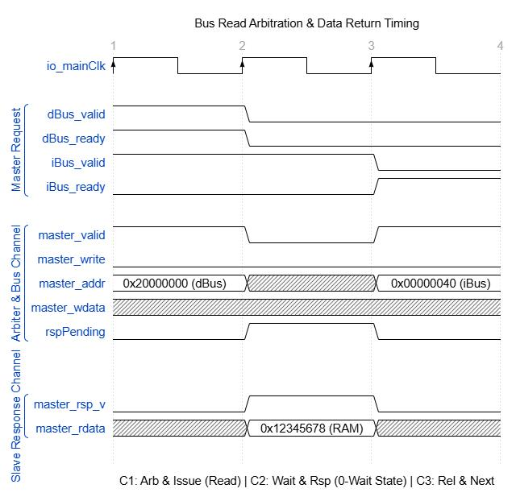
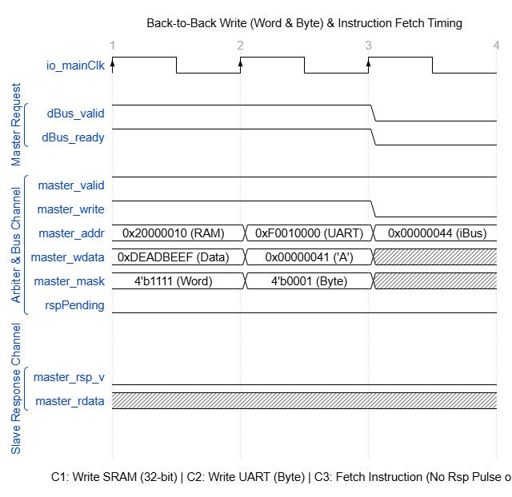
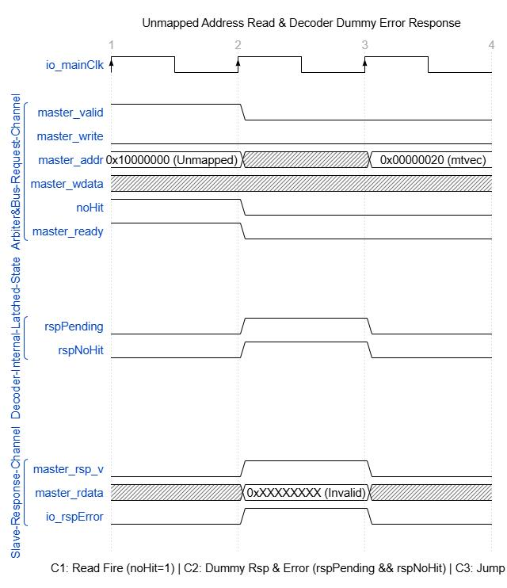

VexRISCV_Bus [[Back](./VexRISCV_SoC.md#pipelinedmemorybus)]
----

`PipelinedMemoryBus` 是一種**Request/Response 分離**的高速單向匯流排,
使用兩個獨立訊號線(Command Request/Response)來避免一定程度的堵塞

## `SafePipelinedMemoryBus`

+ `SafePipelinedMemoryBus` 是繼承自`PipelinedMemoryBus`的客製化
    > 加入了 **防死鎖仲裁器**(MuraxSafeMasterArbiter) 和 **安全解碼器**(MuraxSafePipelinedMemoryBusDecoder)

    - **防死鎖仲裁器**(MuraxSafeMasterArbiter)
        > 負責仲裁 `iBus` 和 `dBus`

        1. 優先權 `dBus > iBus`
            > 執行階段讀寫資料最急,只要 `dBus` 要用,`iBus` 就必須等 1T。

        1. 寫入採 UDP 模式 (Posted Write)
            > CPU 把寫入資料丟進 Bus 就當作完成了(不產生等待狀態 `rspPending`),下 1T 立刻能繼續跑,完全不塞車

        1. 讀取採 TCP 模式 (Single Outstanding)
            > 一旦送出讀取請求,仲裁器立刻舉起紅牌(`rspPending = 1`),把所有新請求擋在門外,直到目標記憶體把資料送回來為止。
            這樣保證回程的資料永遠不會送錯人(不會把 instruction 給成 data)

    - **安全解碼器**(MuraxSafePipelinedMemoryBusDecoder)
        > `PipelinedMemoryBus` 中,如果程式寫錯,去讀寫一個根本不存在的記憶體位址,沒有任何周邊會舉手回應(`ready = 0`),整個系統就會永遠卡死;
        因此安全解碼器加裝了 `noHit(未命中)` 防呆機制
        > + **誤寫非法位址**: 解碼器直接**假裝收下(拉高 ready)**,然後把資料丟進黑洞,匯流排不卡死。
        > + **誤讀非法位址**: 解碼器在下 1T 主動回傳一個假的空包裹,並同時亮起紅燈(`io_rspError = 1`),通知 CPU 觸發異常中斷(Trap),讓韌體有機會救回系統或重啟。


    - 所需的硬體資源預估

| 組成模組                             | 暫存器數量 (Flip-Flops)                                 | 組合邏輯內容                                                       | 預估邏輯閘數 (PSMC 110nm)
| :-                                   | :-                                                    | :-                                                               | :-
| `MuraxSafeMasterArbiter`             | 2 bits (`rspPending`, `rspTarget`)                    | 32-bit 位址二選一多工器、4-bit Byte Mask 移位器、握手閘控             | ~80 – 110 Gates
| `MuraxSafePipelinedMemoryBusDecoder` | 4 bits (`rspPending`, `rspNoHit`, `rspSourceId[1:0]`) | 3 組高有效位元位址比對器（eFlash / SRAM / APB）、回傳資料三選一多工器 | ~70 – 110 Gates
| 總計(SafeBus 核心開銷)                | 僅 6 顆 DFF                                            | 純單向多工與比對邏輯（無三態、無複雜狀態機）                          | ~150 – 220 Gates (佔整體數位邏輯 < 1%)


### 情境 1: 正常讀取(Single Outstanding Read)與資料優先仲裁

讀取時,`master_wdata` 為無效值(Don't Care),目標 Slave(SRAM)會在 **Cycle 2** 透過 `master_rdata` 送回資料。

假設 Cycle 1 時,`iBus`(抓指令)與 `dBus`(讀 SRAM `0x20000000`)同時發出請求,展示 `dBus > iBus` 優先權與 `rspPending` 的鎖定機制:
> `Arb`: `Arbitration`


<details>
<summary>WaveDrom-JSON</summary>

```WaveDromJSON
{
  "signal": [
    { "name": "io_mainClk",    "wave": "P.." },
    {},
    ["Master Request",
      { "name": "dBus_valid",    "wave": "10." },
      { "name": "dBus_ready",    "wave": "10." },
      { "name": "iBus_valid",    "wave": "1.0" },
      { "name": "iBus_ready",    "wave": "0.1" }
    ],
    {},
    ["Arbiter & Bus Channel",
      { "name": "master_valid",  "wave": "101" },
      { "name": "master_write",  "wave": "0.." },
      { "name": "master_addr",   "wave": "=x=", "data": ["0x20000000 (dBus)", "0x00000040 (iBus)"] },
      { "name": "master_wdata",  "wave": "x.." },
      { "name": "rspPending",    "wave": "010" }
    ],
    {},
    {},
    ["Slave Response Channel",
      { "name": "master_rsp_v",  "wave": "010" },
      { "name": "master_rdata",  "wave": "x=x", "data": ["0x12345678 (RAM)"] }
    ],
    {},
  ],
  "head": {
    "text": "Bus Read Arbitration & Data Return Timing",
    "tick": 1
  },
  "foot": {
    "text": "C1: Arb & Issue (Read) | C2: Wait & Rsp (0-Wait State) | C3: Rel & Next"
  },
  "config": {
    "hscale": 4
  }
}
```
</details>
</details>


> + `iBus_ready`: C1 被 `dBus` 擋,C2 被 `rspPending` 擋

+ Cycle 1(競爭與發送): `dBus` 與 `iBus` 同時舉起 valid。
    因 `iBus_cmd_ready = master_ready && !dBus_valid`,`dBus` 優先取得通行權並完成握手(`cmd_fire = 1`)。
+ Cycle 2(單筆鎖定防交錯): 因 C1 是一筆讀取(`!write`),`rspPending` 在 C2 上升沿變為 `1`,同時鎖存 `rspTarget = 1`。
    此時 `when_Murax_l624`(`rspPending && !rsp_valid`)生效,**強制將 `master_valid`、`dBus_ready`、`iBus_ready` 全部壓為 0**,
    直到 SRAM 在 C2 後半拍送出 `ram_rsp_valid = 1`。
+ Cycle 3(解鎖與接續): `rsp_valid` 在 C2 完成資料回傳後,C3 上升沿 `rspPending` 歸 `0`,積壓已久的 `iBus` 立刻獲得 `iBus_ready = 1` 並送出取指位址。


### 情境 2: 背靠背連續寫入(Posted Write 零停頓)

寫入時,**位址(master_addr)與寫入資料(master_wdata)在同一個週期(Address & Data Same-Cycle)一起送出**;
回傳通道(`master_rsp_v` 與 `master_rdata`)完全不動作。

假設 CPU 連續執行兩道 `sw` 指令(先寫 SRAM,下 1T 立刻寫 UART),展示 Posted Write 不觸發 `rspPending` 的高速吞吐特性:

<details>
<summary>WaveDrom-JSON</summary>

```WaveDromJSON
{
  "signal": [
    { "name": "io_mainClk",    "wave": "P.." },
    {},
    ["Master Request",
      { "name": "dBus_valid",    "wave": "1.0" },
      { "name": "dBus_ready",    "wave": "1.0" }
    ],
    {},
    ["Arbiter & Bus Channel",
      { "name": "master_valid",  "wave": "1.." },
      { "name": "master_write",  "wave": "1.0" },
      { "name": "master_addr",   "wave": "===", "data": ["0x20000010 (RAM)", "0xF0010000 (UART)", "0x00000044 (iBus)"] },
      { "name": "master_wdata",  "wave": "==x", "data": ["0xDEADBEEF (Data)", "0x00000041 ('A')"] },
      { "name": "master_mask",   "wave": "==x", "data": ["4'b1111 (Word)", "4'b0001 (Byte)"] },
      { "name": "rspPending",    "wave": "0.." }
    ],
    {},
    {},
    ["Slave Response Channel",
      { "name": "master_rsp_v",  "wave": "0.." },
      { "name": "master_rdata",  "wave": "x.." }
    ],
    {},
    {},
  ],
  "head": {
    "text": "Back-to-Back Write (Word & Byte) & Instruction Fetch Timing",
    "tick": 1
  },
  "foot": {
    "text": "C1: Write SRAM (32-bit) | C2: Write UART (Byte) | C3: Fetch Instruction (No Rsp Pulse on Writes)"
  },
  "config": {
    "hscale": 4
  }
}
```
</details>
</details>


> + `dBus_ready`: 連續 2T (C1/C2) 皆為 1
> + `master_write`: C1/C2 為 Write, C3 為 Read
> + `rspPending`: 全程保持 0
> + `master_rsp_v`: 寫入不產生回應脈衝


+ Cycle 1 & 2(射後不理): `when_Murax_l619` 條件為`cmd_fire && (!write)`。因為 2T 都是寫入(`write = 1`),**`rspPending` 完全不會被拉高**。
+ 零停頓優勢: 寫入指令在 `cmd_fire` 當拍即宣告退休(`Retire`),
    C1 寫 SRAM、C2 寫 APB Bridge(由 Bridge 內部的 `halfPipe` 緩衝吸收)、C3 立刻服務 `iBus` 讀取,達成 **100% 匯流排利用率**。


### 情境 3: 誤讀未映射位址(SafeBus 防死鎖與異常觸發)

誤讀非法位址(`0x10000000`)時, Cycle 2 的 `master_rdata` 會輸出 Decoder 內部的多工預設值(`system_apbBridge_io_pipelinedMemoryBus_rsp_payload_data` 的殘留值),
但因為同時拉高了 `io_rspError = 1`, CPU 會直接忽略 `master_rdata` 並跳轉進 Trap。

假設韌體指標錯誤,CPU 讀取 `0x10000000`(未映射空位址),展示 `noHit` 如何代替實體 Slave 完成握手並觸發 `mcause = 5`(Load Access Fault):

<details>
<summary>WaveDrom-JSON</summary>

```WaveDromJSON
{
  "signal": [
    { "name": "io_mainClk",    "wave": "P.." },
    {},
    ["Arbiter&Bus-Request-Channel",
      { "name": "master_valid",  "wave": "10." },
      { "name": "master_write",  "wave": "0.." },
      { "name": "master_addr",   "wave": "=x=", "data": ["0x10000000 (Unmapped)", "0x00000020 (mtvec)"] },
      { "name": "master_wdata",  "wave": "x.." },
      { "name": "noHit",         "wave": "10." },
      { "name": "master_ready",  "wave": "10." }
    ],
    {},
    {},
    {},
    ["Decoder-Internal-Latched-State",
      { "name": "rspPending",    "wave": "010" },
      { "name": "rspNoHit",      "wave": "010" }
    ],
    {},
    {},
    {},
    {},
    ["Slave-Response-Channel",
      { "name": "master_rsp_v",  "wave": "010" },
      { "name": "master_rdata",  "wave": "x2x", "data": ["0xXXXXXXXX (Invalid)"] },
      { "name": "io_rspError",   "wave": "010" }
    ],
    {},
  ],
  "head": {
    "text": "Unmapped Address Read & Decoder Dummy Error Response",
    "tick": 1
  },
  "foot": {
    "text": "C1: Read Fire (noHit=1) | C2: Dummy Rsp & Error (rspPending && rspNoHit) | C3: Jump to mtvec"
  },
  "config": {
    "hscale": 4
  }
}
```
</details>
</details>


> + `noHit`: 組合邏輯即時解碼
> + `master_ready`: `noHit` 強制拉高 ready
> + `rspPending`: C1 讀取 fire 後鎖存為 1
> + `rspNoHit`: C1 取樣 `noHit`, C2 上升沿鎖存 `noHit`
> + `master_rdata`: 因 `rspError=1` 被 CPU 丟棄
> + `master_rsp_v`(=`rspPending && rspNoHit`): valid
> + `io_rspError`(=`rspPending && rspNoHit`): 觸發 Load Access Fault

+ Cycle 1(吸收請求): 位址 `0x10000000` 不屬於 eFlash、SRAM 或 APB,組合邏輯 `noHit = 1`。
    Decoder 透過 `master_ready = (... || noHit)` 主動放行握手,避免匯流排卡死;
    同時在時脈上升沿將 `rspPending` 與 `rspNoHit` 皆鎖存為 `1`。
+ Cycle 2(單週期錯誤回報): 由於 `rspPending && rspNoHit` 同時為 `1`,Decoder 主動拉高 `master_rsp_v` 與 `io_rspError` 各 1 個週期。
    Arbiter 根據 `rspTarget` 將 `dBus_rsp_error` 送入 `VexRiscv Execute` 階段。
+ Cycle 3(安全跳轉): CPU 接收到 `dBus_rsp_error`,立即沖刷管線並跳轉至 `0x00000020`(`trap_entry`),`rspPending` 歸 `0`,系統完全恢復正常運作


## `PipelinedMemoryBus` vs. `AMBA (AHB-Lite)`


| 比較維度                 | SafePipelinedMemoryBus                                                                                                       | 標準 AMBA AHB-Lite
|:-                       | :-                                                                                                                           | :-
| 握手協定(Handshake)      | **Valid / Ready 雙向流控**(AXI-Stream 風格):`cmd`與`rsp` 通道各自獨立,`cmd_valid && cmd_ready` 成立即完成命令發送。               | **HREADY 單向全域停頓**:Address Phase 與 Data Phase 緊密耦合,當 `HREADY = 0 `時,整個匯流排(包含所有 Slave 與下一個位址)**必須同時凍結**。
| 讀寫管線交疊(Overlap)    | **僅有限度交疊**:寫入為單週期 Posted Write(可背靠背連續發送); 但讀取會拉高` rspPending` 鎖住整個匯流排,直到下一拍 `rsp_valid` 返回。  | **完全管線交疊(Full Pipelining)**:在 Cycle N 傳輸 A 交易的 Data Phase 時,Cycle N 的匯流排上已經在進行 B 交易的 Address Phase(無論讀或寫,0 Wait State 下可達 1 筆/週期吞吐量)。
| 突發傳輸(Burst)          | **無原生支援**:每次傳輸皆為獨立的單筆 32-bit 交易(透過 `4-bit mask` 支援 Byte/Halfword 寫入)。                                     | **完整支援**:具備 `HBURST[2:0]`(SINGLE, INCR, WRAP4/8/16, INCR4/8/16)與 `HSIZE[2:0]`,適合 DMA 與 Cache Line 填充。
| 錯誤回應(Error Response) | **單週期脈衝(1-Cycle Pulse)**:`io_rspError` 僅在 `rsp_valid` 當拍拉高 1 週期。                                                   | **兩週期協定(2-Cycle Protocol)**:`HRESP = ERROR` 時,第一拍必須搭配 `HREADY = 0`,第二拍搭配 `HREADY = 1`,以通知 Master 取消管線中的下一筆 Address Phase。
| 寫入交易延遲與精確異常    | **Posted Write**:寫入不回傳 `rsp_valid` 與 `rspError`,寫入速度極快,但**無法觸發 Store Access Fault (`mcause = 7`)**。             | **Non-Posted Write**:寫入必須經過 Data Phase 確認,Slave 可在寫入無效位址時回傳 `HRESP = ERROR`,支援精確的寫入匯流排錯誤異常(BusFault)。
| 多主控仲裁(Multi-Master) | 外部獨立仲裁器(`MuraxSafeMasterArbiter`),在 `cmd` 通道直接做多工與 `ready` 遮蔽。                                                 | AHB-Lite 本身規範為**單一 Master**；若需多 Master,必須使用 **AHB Bus Matrix**(多層互連矩陣)或升級至完整版 AHB(含 `HBUSREQ/HGRANT`)。
| ASIC 邏輯開銷與時序收斂   | **極低**:無需處理 `HTRANS`(IDLE/BUSY/NONSEQ/SEQ)狀態機與複雜的 `HREADYOUT` 回授組合路徑,在 110nm 製程極易達到 `>100 MHz`。         | **中等**:`HREADY` 為全域扇出(High Fan-out)且涉及所有 Slave 的組合邏輯回授,在大型 SoC 中容易成為關鍵路徑(Critical Path)。


+ `AHB-Lite`: 位址(HADDR)在 Cycle 1,寫入資料(HWDATA)會延遲一拍到 Cycle 2(Data Phase)才出現。
+ `PipelinedMemoryBus`: 寫入資料(`master_wdata`)與位址(`master_addr`)在 **Cycle 1 同拍送出**,完全沒有額外的 Data Phase 狀態機延遲。


