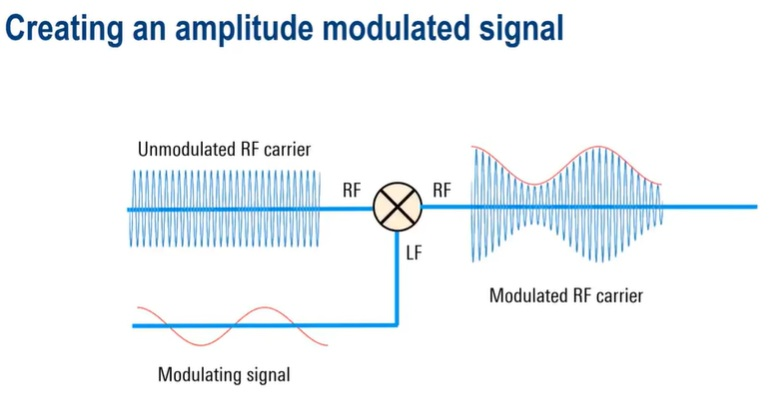
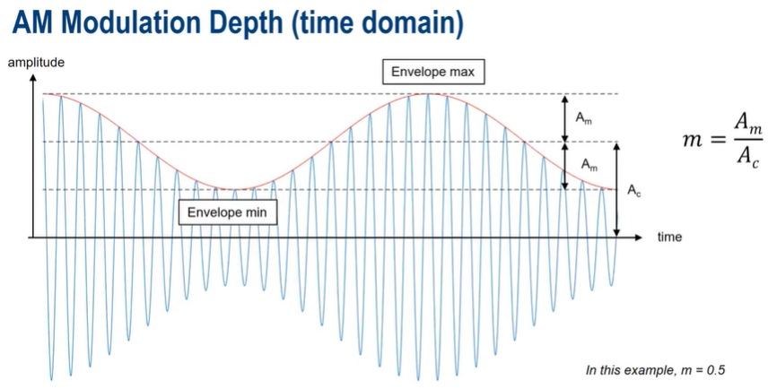
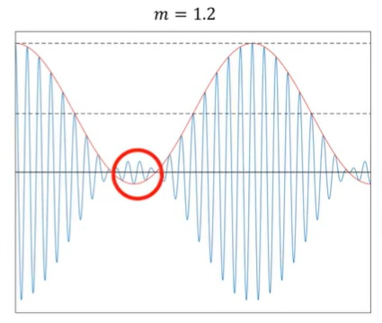
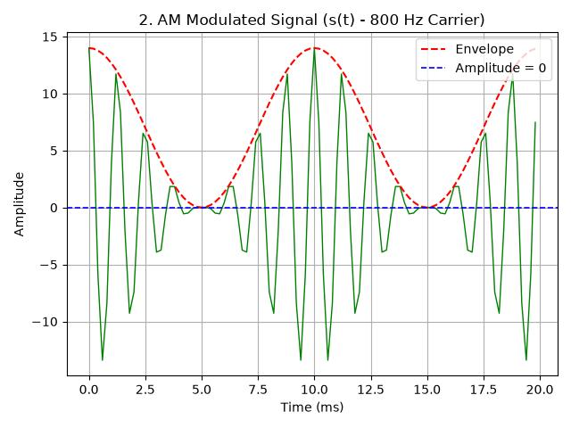
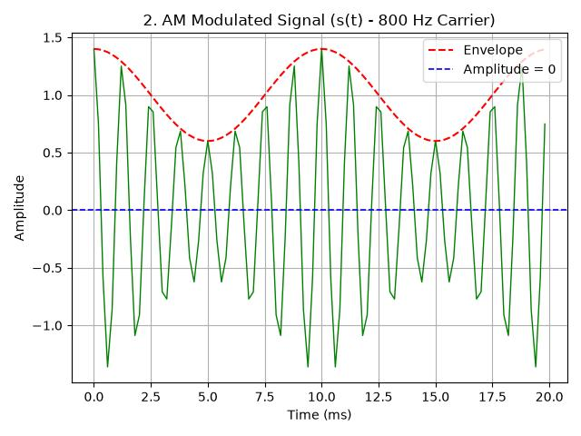
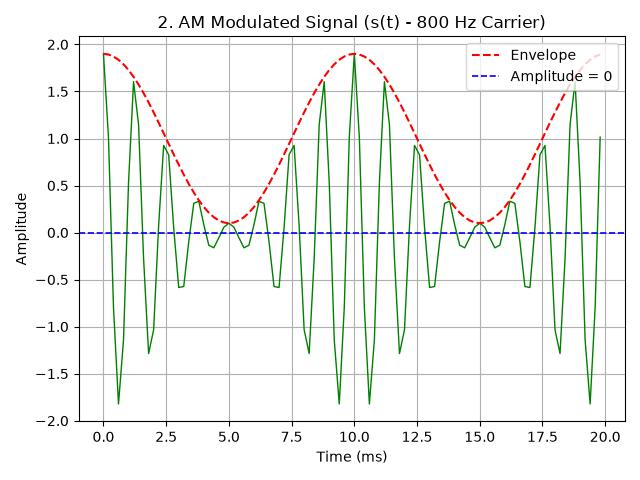
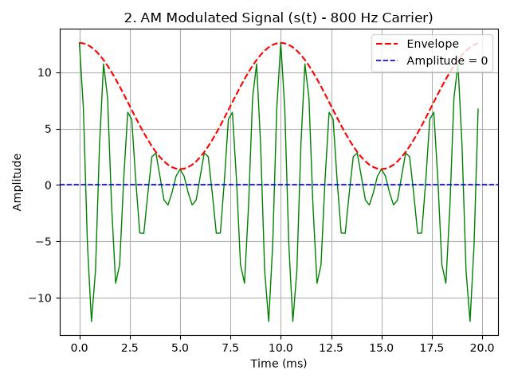

Signal Concept
---

# Amplitude Modulation (AM)



AM 就是將 data signal (紅色線) 與 carrier 做調變後輸出
> data 被乘載在 carrier 震幅的包絡線(Envelope)

下圖是 time domain 的 waveform <br>

> + m: Modulation Index, `0 < m <= 1`
> + Ac: Amplitude of a carrier
> + Am: Difference of Midpoint to Peak (Envelope Min or Max)

Am 不能大於載波震幅(最大震幅就是載波), 也不能小於等於 0 (0 就等於 carrier 本身)
> Over Modulation (相位反轉) 即代表 `Am < 0` 的情況
> 

## 將 Amplitude Modulation 應用於 Touched-Signal

將 touched/non-touched 訊號當作 binary, 用 `data 0 ` 表示 non-touched, `data 1` 表示 touched.

把 Chip I/O 當作天線, 從 Pin 發出 carrier (Transmitter), 再由同一個 Pin 接收 Carrier (Receiver),
發出的 Carrier 會將 PCB 上的狀態 (`觸摸自容式觸控時, 會增加訊號能量`) 攜帶回來, 再經由觸控演算法來判別

AM 應用到觸控偵測時, **Envelope_Min** 為 non-touched 狀態, **Envelope_Max** 為 touched 狀態


**Envelope_Min** 和 **Envelope_Max** 會因外界干擾因子而上下震盪,
因此最理想的情況是 **Envelope_Min** 為 `0`, 而 **Envelope_Max** 則為 `Carrier 最大值`,
touched/non-touched 訊號離的最遠, 最容易判別 (如下圖).<br>



+ **Envelope_Min** 會因 `PCB 的等效電容`或`其他雜訊`而抬升遠離 `0` 點,
    導入 `Offset Compensation` 來抵銷 PCB 的等效電容, 進而讓 **Envelope_Min** 靠近 `0` 點
    > + 環境雜訊多, **Envelope_Min** 偏離 `0` 點
    >> 

    > + 環境乾淨, **Envelope_Min** 接近 `0` 點
    >> 

    - `Offset Compensation` 有可能補償過頭, 造成 Over Modulation

        


+ `Offset Compensation` 補償公式
    > ```
    > Q = Capacitor * Voltage
    >
    > V_sig = (V_ref / 2) - V_comp
    >
    > C_parasitic > Cs_estimate
    > C_parasitic > ((V_ref - V_sig) * C_comp) / V_sig
    >
    > C_parasitic * V_sig > (V_ref - V_sig) * C_comp
    >         Q_sig       >     Q_c_comp
    >
    > ```
    > + `Q` 為電荷
    > + `C_parasitic` 為 PCB 的等效電容, 可視為定值
    > + `V_sig` 為 Carrier 能量 (Amplitude of a carrier, Ac)
    > + `Cs_estimate` 為`補償參數`經數學模型, 換算的抵銷電容值

    - 為了避免 Over Modulation, 必須調整 `V_comp` 或 `C_comp`, 讓 `C_parasitic > Cs_estimate` 成立.
        > + 當 `C_parasitic > Cs_estimate` 成立, 表示 **Envelope_Min** 接近 `0` 點且沒有造成 Over Modulation
        > + Carrier 能量 `V_sig` 增加時, **Envelope_Max** 就越大, SNR 也就越好
        >> 當 `C_comp` 增加時, 依照 `C_parasitic * V_sig > (V_ref - V_sig) * C_comp`,
        `C_parasitic` 為定值, `V_sig` 勢必得跟著增加 (`C_comp`增加等同 Carrier 能量增強)

        

    - Channel_Gain
        > 當訊號極小時, 利用 Channel_Gain 將整體訊號放大 (**Envelope Min/Max 等比放大**), 以便於計算

        1. **Envelope_Min** 和 **Envelope_Max** 等比放大時, SNR 不會改變, 但 Amplitude 量級變大(如下圖)

            


# Reference

+ [Understanding Amplitude Modulation - YouTube](https://www.youtube.com/watch?v=I46eP8uZh_Y)


